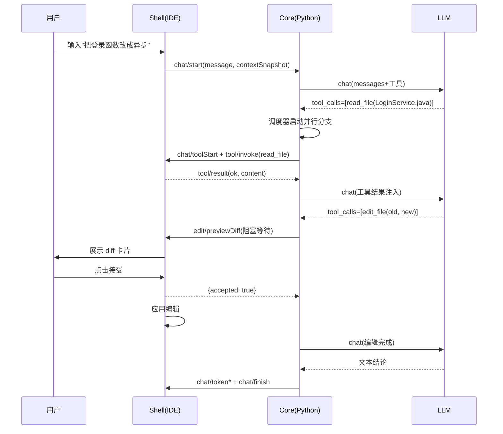

# Agent 辅助编码插件详细设计说明书（DD v1.0）

**依据**：方案 v3（Python 核心 · 多语言混合架构）
**范围**：RPC 协议、Python Core、Rust 扩展、IntelliJ Shell、VSCode Shell、配置与安全
**兼容目标**：IntelliJ 全家桶（build 252–262）+ VSCode；辅助编码语言：py/rust/js/ts/java/go/c/cpp 等

---

## 1. 总体架构与进程模型

### 1.1 组件职责

| 组件 | 语言 | 职责 | 明确不做 |
|---|---|---|---|
| Agent Core | Python 3.10+ | LLM 调用、Agent 循环、并行调度、Subagent、MCP、记忆、Skill、RPC 服务端 | 不直接读写用户文件系统（除自身数据目录）；不依赖任何 IDE API |
| Rust 扩展 | Rust(PyO3) | token 精确计数、tree-sitter 多语言解析 | 不参与业务编排 |
| IntelliJ Shell | Java 21 | UI、diff 预览、PSI 工具、终端、文件写、设置 | 不做 LLM 调用 |
| VSCode Shell | TypeScript | 同上（VSCode 生态实现） | 不做 LLM 调用 |

### 1.2 进程生命周期

```
IDE 打开项目
  → Shell 探测运行时（Python 路径/发行产物）
  → 拉起 Core 子进程（--project-id --data-dir 参数）
  → Core 发 core/hello → Shell 回 ide/hello（版本握手）
  → 常驻，3s 心跳；断线 → Shell 自动重启 Core → Core 从数据目录恢复会话快照
IDE 关闭项目/退出
  → Shell 发 shutdown 通知 → Core 落盘会话快照 → 优雅退出
```

### 1.3 目录结构

```
workreport-agent/
├── core/                          # Python Agent Core
│   ├── pyproject.toml             # uv 管理，requires-python>=3.10
│   ├── src/agent_core/
│   │   ├── rpc/{server,protocol,connection}.py
│   │   ├── llm/{providers/,streaming,context,router}.py
│   │   ├── agent/{loop,scheduler,subagent,permissions}.py
│   │   ├── tools/{registry,builtin/,remote}.py
│   │   ├── mcp/{manager,bridge}.py
│   │   ├── memory/{sqlite_store,files,vector}.py
│   │   ├── skills/loader.py
│   │   └── native/                # Rust 扩展 crate（maturin）
│   │       ├── tokenizer/
│   │       ├── codesoup/
│   │       └── sse_fast/
│   ├── skills/                    # 内置 skills（daily-report 等）
│   └── tests/
├── intellij/                      # Java 21 Shell（原项目改造）
│   └── src/main/java/com/workreport/agent/{rpc,tools,ui,settings,actions,legacy}
├── vscode/                        # TypeScript Shell
│   └── src/{extension,panel,tools,diff,settings}.ts
├── scripts/                       # CI：maturin wheels、PyInstaller、协议一致性测试
└── docs/                          # 设计文档与 ADR
```

---

## 2. RPC 协议详设

### 2.1 传输与帧格式

- 传输：**stdio**，双向全双工
- 帧：**JSON Lines**——每行一个完整 UTF-8 JSON 对象，`\n` 分隔；禁止消息体含裸换行
- 单帧上限 16MB（大文件内容走分块：文件工具返回 {truncated, totalChars} 而非超限字节）

### 2.2 信封结构

```json
{ "id": "uuid-v4", "method": "chat/token", "params": { }, "ts": 1762228800000 }
```

- **请求-响应型**：Core 发 `tool/invoke` 等，Shell 必须回：`{"id": "同请求id", "ok": true, "result": {...}}` 或 `{"id": "...", "ok": false, "error": {"code": "TOOL_TIMEOUT", "message": "..."}}`
- **通知型**（无响应）：`chat/token`、`chat/toolProgress`、`chat/finish` 等
- **双向可发**：任意一侧都可以是请求方（diff 确认由 Core 发起并阻塞等待）

### 2.3 版本协商与心跳

```
Core → { "method": "core/hello", "params": {"protocolVersion": "1.0", "coreVersion": "0.1.0", "capabilities": ["mcp", "subagent", "memory", "skill", "parallel-tools", "session-store"]} }
IDE  → { "method": "ide/hello", "params": {"protocolVersion": "1.0", "ide": "idea|webstorm|pycharm|vscode", "tools": ["read_file", ...]} }
心跳：Core → { "method": "agent/ping" }，IDE 回 { "id": ..., "ok": true, "result": {"pong": true} }，3s 间隔，10s 超时判死
```

### 2.4 消息全集

| 方向 | 方法 | 类型 | 关键参数 |
|---|---|---|---|
| IDE→Core | `chat/start` | 请求 | `{sessionId, message, contextSnapshot}` → 返回 `{taskId}` |
| IDE→Core | `chat/cancel` | 通知 | `{taskId?}`（缺省取消全部） |
| IDE→Core | `settings/update` | 通知 | `{settings}` |
| IDE→Core | `session/list` | 请求 | `{}` → `{sessions: [{id, title, preview, messageCount, updatedAt}]}`（按 `updatedAt` 倒序，最多 50 条） |
| IDE→Core | `session/get` | 请求 | `{sessionId}` → `{id, title, updatedAt, messages: [{role, content}]}`（只含 user / assistant 非空正文，供回放） |
| IDE→Core | `session/delete` | 请求 | `{sessionId}` → `{deleted: bool, freedBytes: int}`（先取消该会话在跑的任务，再同时清内存与磁盘，`.tmp` 残留一并删除） |
| IDE→Core | `tool/result` | 请求 | `{taskId, toolCallId, ok, result?, error?}` |
| IDE→Core | `ui/event` | 通知 | `{taskId, event, payload}`（diff 接受/拒绝、确认结果） |
| Core→IDE | `chat/token` | 通知 | `{taskId, delta}` |
| Core→IDE | `chat/toolStart` | 通知 | `{taskId, toolCallId, toolName, args}` |
| Core→IDE | `chat/toolProgress` | 通知 | `{taskId, toolCallId, progressText}` |
| Core→IDE | `chat/toolEnd` | 通知 | `{taskId, toolCallId, ok, summary}` |
| Core→IDE | `chat/finish` | 通知 | `{taskId, fullText, usage}` |
| Core→IDE | `chat/error` | 通知 | `{taskId, error}` |
| Core→IDE | `tool/invoke` | 请求 | `{taskId, toolCallId, toolName, params}` → 响应 `tool/result` |
| Core→IDE | `edit/previewDiff` | 请求 | `{taskId, toolCallId, filePath, diff, snapshots}` → 响应 `{accepted: bool}`（阻塞等用户） |
| Core→IDE | `agent/confirm` | 请求 | `{taskId, message, options[], defaultOption}` → 响应 `{selected}` |

### 2.5 错误码表

| 码 | 含义 | 处理 |
|---|---|---|
| `PROTOCOL_ERROR` | 帧/版本不符 | 记录并断开 |
| `TOOL_NOT_FOUND` | 工具未注册 | 错误注入 LLM，让它换工具 |
| `TOOL_PERMISSION_DENIED` | 权限拒绝 | 同上 + 通知用户 |
| `TOOL_TIMEOUT` | 单工具超时 | 取消该分支，继续其它并行分支 |
| `TOOL_EXEC_ERROR` | 工具执行异常 | 错误注入 LLM 自纠一次 |
| `LLM_ERROR` | 模型/网络错误 | 用户可见错误，保留会话可重试 |
| `CANCELLED` | 用户取消 | 静默终止 |
| `CONTEXT_OVERFLOW` | 上下文超预算 | 触发自动压缩后重试 |

### 2.6 关键时序：一次含编辑的 chat



---

## 3. Python Core 详设

### 3.1 核心数据模型（pydantic v2）

```python
class Role(StrEnum): SYSTEM="system"; USER="user"; ASSISTANT="assistant"; TOOL="tool"

class ToolCall(BaseModel):
    id: str
    name: str
    arguments: dict[str, Any]

class Message(BaseModel):
    role: Role
    content: str | None = None
    tool_calls: list[ToolCall] | None = None   # role=assistant 且含调用时
    tool_call_id: str | None = None            # role=tool 时回填
    name: str | None = None                    # role=tool 时的工具名

class ToolDef(BaseModel):
    name: str
    description: str                           # prompt 质量关键，模板化评审
    parameters: dict[str, Any]                 # JSON Schema
    permission: Literal["auto","preview","confirm"] = "auto"
    timeout_sec: float = 30.0
    max_concurrency: int = 4                   # 该工具自身并发上限
    remote: bool = True                        # True=转发 Shell 执行

class ToolResult(BaseModel):
    tool_call_id: str
    ok: bool
    content: str | None = None                 # 注入 LLM 的文本
    error: str | None = None

class ContextSnapshot(BaseModel):              # Shell 传来的上下文
    project_root: str
    current_file: FileInfo | None = None
    selection: str | None = None
    cursor: Position | None = None
    open_files: list[FileInfo] = []
    diagnostics: list[Diagnostic] = []

class ChatConfig(BaseModel):                   # 每次 chat 生效的运行配置
    provider: Literal["openai_compat","ollama"]
    model: str; temperature: float; max_tokens: int
    max_iterations: int = 40                  # v2.4.0 起默认 40，设置页可调 5~300
    tool_concurrency: int = 4
    subagent_concurrency: int = 3
    permissions: PermissionsConfig
```

### 3.2 LLM 层

**Provider 接口**（`llm/providers/base.py`）：

```python
class LLMProvider(Protocol):
    provider_id: str
    async def chat_stream(self, messages: list[Message], tools: list[ToolDef] | None,
                          config: ChatConfig,
                          on_token: Callable[[str], Awaitable[None]],
                          on_tool_call: Callable[[ToolCall], Awaitable[None]]) -> ChatResult: ...
    def count_tokens(self, text: str) -> int: ...
```

- `openai_compat`：`openai` SDK `AsyncOpenAI(base_url=...)`，覆盖 DeepSeek/Qwen/vLLM 等一切兼容端点
- `ollama`：`ollama` SDK `AsyncClient`，base_url 可配
- `ChatResult` = `{content, tool_calls, finish_reason, usage{in,out}}`
- **router**：单 provider 故障转移策略（同 provider 换模型 → 异 provider），首版实现"失败重试 1 次 + 切换 Ollama 兜底"

**SSE 流式与 tool_calls 累积状态机**（`llm/streaming.py`）：

OpenAI 兼容流的 `delta.tool_calls` 是**增量数组**，按 `index` 累积：

```
accumulator: dict[int, Slot]; Slot = {id?, name?, args_buffer: str}
on_chunk(delta):
  for tc in delta.tool_calls:
    slot = accumulator[tc.index]
    slot.id ||= tc.id                      # 仅首 chunk 携带
    if tc.function.name: slot.name = tc.function.name
    if tc.function.arguments: slot.args_buffer += tc.function.arguments
on_stream_end():
  for slot in sorted(accumulator):
    tool_call = ToolCall(slot.id, slot.name, json.loads(slot.args_buffer))
    await on_tool_call(tool_call)
```

Ollama 流的 `message.tool_calls` 为**整对象**（非增量），但参数可能在多 chunk 中重复携带——按 `name+index` 键合并，`arguments` 为 JSON 对象时深合并、为字符串时累积拼接后统一解析。两种格式都做 `[DONE]` 与 `finish_reason` 终止判定；解析失败的单 chunk 记 warning 不中断流。

**文本态工具调用兜底**（`llm/tool_text.py`，v2.4.2）：

部分端点（vLLM 未开 `--tool-call-parser`、Ollama 模型不支持 tools、或模型 chat template 自己把调用印在正文里）根本不回 `delta.tool_calls`，标记会混在 `content` 里（早期版本直接当普通文字显示，工具不执行）。现在两个 provider 都在 `chat_stream` 里做两件事：

1. `TextToolCallFilter`：流式过滤，识别 `<tool_call>` / `<function=` 标记（最多 hold 10 个字符以处理跨 chunk），标记区间内不向 Shell 发 token，收尾时丢弃未闭合块
2. `recover_text_tool_calls(content)`：流结束后若没有结构化 `tool_calls`，就从正文中解析 Hermes/Qwen 的 `<function=name><parameter=k>v</parameter></function>` 形态或 `{"name":…,"arguments":{…}}` JSON 形态，生成 `ToolCall(id="txt_…")`，同时从正文里剔掉标记；纯文本回答原样返回

`ChatResult.content` 返回剔除标记后的文本，下一轮 `trim_history` / 上下文预算不受影响。

**上下文预算与压缩**（`llm/context.py`）：
- 预算分配：system prompt 固定 ≤ 2k → 工具定义 ≤ 2k → 记忆/Skill ≤ 2k → 历史 → 上下文快照 → 预留输出 2k
- 计数走 `native.tokenizer`（tiktoken-rs）；历史超限触发压缩：保留最近 3 轮，更早的 assistant 工具轮次折叠为 `[工具摘要] 读 X → 改 Y` 一句话（由一次低成本 LLM 调用生成摘要，失败则截断）
- **实际落地的裁剪**（`trim_history`，v2.4.3）：两趟——①按整个旧对话丢（提问 + 回答一起），只留最新一轮；②仍超预算再丢本轮较早的 assistant/tool 轮（带 `tool_calls` 的 assistant 与其 `tool` 结果同进同出）。**最新一轮的 user 提问永不被丢**，否则请求会变成“一条 user 都没有”，vLLM 直接 `400 No user query found in messages.`；`loop.py` 在裁剪后还有一层兜底补回

### 3.3 Agent 引擎

**循环状态机**（`agent/loop.py`）：

```python
async def run_chat(session: Session, user_msg: str, config: ChatConfig, emit: Emitter):
    messages = await assemble(session, user_msg)        # 记忆召回+skill指令+快照
    for i in range(config.max_iterations):
        if session.cancel_flag: raise Cancelled()
        resp = await provider.chat_stream(messages, tools=registry.schemas(), ...)
        if resp.tool_calls:
            results = await scheduler.run_parallel(resp.tool_calls, session)
            messages += to_messages(resp, results)       # assistant(tool_calls) + tool 结果
        else:
            return resp                                 # 流式已由 on_token 发出
    raise IterationLimitExceeded()                      # 兜底：让 LLM 输出当前进展小结
```

状态：`IDLE → THINKING → EXECUTING → THINKING … → RESPONDING → IDLE`，`CANCELLED` 任意态可达。

**并行调度器**（`agent/scheduler.py`）：

```
run_parallel(tool_calls, session) -> list[ToolResult]:
  1. 按 ToolDef 声明与调用参数构建 DAG（默认无依赖 → 全并行）
  2. 拓扑分层；同层并发 = min(config.tool_concurrency, 各工具 max_concurrency 余量)
  3. 每个分支 asyncio.create_task + asyncio.timeout(独立超时)
  4. 分支取消：只取消本 task，不传播异常；结果按原顺序返回
  5. 远程工具 → rpc 客户端请求；本地工具（memory_*/skill_load）→ 直接协程
  6. 全程经 emit 向 Shell 发 toolStart/toolProgress/toolEnd
```

**Subagent 池**（`agent/subagent.py`）：

```python
class SubagentTask(BaseModel):
    id: str
    goal: str
    allowed_tools: list[str]
    system_prompt: str
    max_iterations: int = 5

class SubagentPool:
    def __init__(self, max_concurrent: int = 3): ...
    async def dispatch(self, tasks: list[SubagentTask], emit) -> list[SubagentReport]
    # 每个 subagent = 独立 asyncio.Task + 独立 LLM 会话 + 独立迭代上限
    # 池满排队；结果 SubagentReport{task_id, ok, summary(进主上下文前先压缩), detail}
```

内置 subagent 定义（`.agent/subagents/*.md`，与 SKILL.md 同格式）：`code-reviewer`、`bug-hunter`、`test-generator`。

### 3.4 工具系统

**注册与声明**（`tools/registry.py`）：

```python
@tool(name="read_file", permission="auto", timeout_sec=10, max_concurrency=8,
      description="读取文件指定行范围（1 起始，含两端）。大文件请配合 list 行数使用。")
async def read_file(path: str, start_line: int = 1, end_line: int | None = None) -> ToolResult: ...
```

- pydantic 签名 → 自动生成 JSON Schema；执行期校验参数
- **工具清单**：

| 工具 | 类型 | 权限 | 位置 |
|---|---|---|---|
| `read_file` / `list_dir` / `search_code` / `search_symbol` / `git_status` / `git_diff` / `git_log` / `get_diagnostics` | 只读 | auto | Shell |
| `write_file` / `edit_file` / `delete_file` | 编辑 | preview | Shell |
| `run_terminal` / `run_test` | 执行 | confirm | Shell |
| `open_file` / `goto_symbol` | IDE 操作 | auto | Shell |
| `skill_load` / `memory_recall` / `memory_save` / `memory_delete` / `subagent_dispatch` | 内置 | auto/confirm | Core |

- **权限引擎**（`agent/permissions.py`）：`auto` 直通；`preview` 走 `edit/previewDiff` 阻塞确认（会话级"本次自动接受"开关）；`confirm` 走 `agent/confirm`；命令白名单匹配失败即拒。连续 3 次权限拒绝 → 终止循环并汇报。
- **文本解码**（Shell `tools/FileText.java`，v2.4.2）：`read_file` / `search_code` / `write_file` / `edit_file` / `revert_file` 统一走它——先看 BOM（UTF-8 / UTF-16 LE / BE），再严格 UTF-8，再 GBK，最后有损 UTF-8；写回沿用探测到的编码与 BOM。PowerShell 5 重定向出的 UTF-16 日志不会再报 `Input length = 1`（`MalformedInputException`）

### 3.5 记忆系统

**SQLite schema**（`memory/sqlite_store.py`，stdlib sqlite3，Core 数据目录）：

```sql
CREATE TABLE memories (
  id INTEGER PRIMARY KEY AUTOINCREMENT,
  title TEXT NOT NULL, content TEXT NOT NULL,
  category TEXT NOT NULL,
  keywords TEXT NOT NULL,               -- JSON 数组
  scope TEXT NOT NULL,                  -- project | global
  project_path TEXT,
  created_at INTEGER, updated_at INTEGER
);
CREATE VIRTUAL TABLE memories_fts USING fts5(title, content, keywords,
        content='memories', content_rowid='rowid');
```

**文件侧**（`memory/files.py`）：每条记忆同时落 Markdown——项目 `.agent/memories/*.md`、全局 `~/.agent/memories/*.md`；`.agent/memories/overview.md` 为层级树索引（标题+分类一行一条），Core 启动时解析为 overview 结构。

**检索两级**：
1. `memory_recall(mode="overview")` → 返回 overview 文本（便宜）
2. `mode="search", keywords` → FTS5 全文 + 关键词加权，Top-N 返回；可选 `vector.py`（usearch + 本地 embedding）做语义召回，首版关闭

### 3.6 MCP 集成（`mcp/manager.py`）

```python
class MCPServerConfig(BaseModel):
    name: str
    transport: Literal["stdio","sse","http"]
    command: str | None = None; args: list[str] | None = None
    url: str | None = None
    enabled: bool = True
    auto_approve: bool = False
```

- 官方 `mcp` SDK；启动即 `list_tools` → 经 `bridge.py` 转 `ToolDef` 注册进 registry（权限：`auto_approve ? auto : confirm`）
- 生命周期：启动失败不阻塞主流程；调用超时熔断 30s；进程异常退出自动重启 ≤ 3 次后禁用并通知
- 配置源：项目 `.agent/mcp.json`（版本管理、团队共享）+ IDE 设置页（个人私有），合并时项目级优先

### 3.7 Skill 系统

**SKILL.md 规范**：

```markdown
---
name: daily-report
description: 生成日报/周报/季报/年报；聚合今日 Git 提交并 AI 润色
scenarios: ["生成日报", "今日工作汇报", "写周报"]
tools: [git_log, run_terminal]        # 可选：建议工具白名单
---
# 指令
1. 调用 git_log 采集用户指定日期范围的提交
2. 按板块组织：今日完成/明日计划/遇到的问题
3. 保留技术术语，不捏造事实
```

- `skills/loader.py`：扫描 `~/.agent/skills/` 与项目 `.agent/skills/`；`skill_load(name)` 把正文注入 messages；名称冲突项目级优先
- **日报 Skill**：旧 Java 端 4 套 prompt（daily/weekly/quarterly/yearly）原文迁移为 4 个 skill 文件，参数化报告类型；Git 采集由 Shell `git_log` 工具承担（对应旧 `GitLogCollectorService` 改造）

---

## 4. Rust 扩展详设

### 4.1 边界原则

每个扩展必须有**纯 Python 降级路径**（构建失败/平台无 wheel 时可用）：
- `tokenizer` 降级：字符数 ÷ 4 启发式估算
- `codesoup` 降级：返回空解析，上下文裁剪回退到全文截断，符号查询回退 Shell 端 PSI

### 4.2 `native.tokenizer`（tiktoken-rs + PyO3）

```python
count_tokens(text: str, model: str = "gpt-4o") -> int
truncate_to_budget(text: str, budget_tokens: int, model: str) -> str   # 回退到句子边界
```

实现要点：`PyO3` + `py.allow_threads`（释放 GIL）；模型→编码映射表内置（gpt-4o/o200k、cl100k 兼容 Ollama 模型默认用 o200k）。

### 4.3 `native.codesoup`（tree-sitter）

```python
class FunctionNode: name: str; signature: str; start_line: int; end_line: int; language: str
class ParsedFile:
    language: str
    functions: list[FunctionNode]
    query(s_expr: str) -> list[Node]        # tree-sitter query，返回行号区间+捕获文本

parse_text(content: str, language: str) -> ParsedFile
detect_language(path: str, content: str) -> str | None
```

- grammar 内置：python、rust、javascript、typescript、java、go、c、cpp、csharp（每个 grammar 独立 feature，按需加载解析器，惰性初始化）
- 用途：① 上下文函数级切片（只送相关函数入 LLM）② `search_code` 的结构化增强 ③ edit_file 的 diff 前后结构校验（改后 AST 可解析才允许提交）

### 4.4 构建与集成

- maturin 产 `native-{pyver}-{os}-{arch}.whl`，CI 矩阵 3 OS × 2 arch
- Core 启动时 import 失败 → 降级路径 + 通知 Shell 展示"性能扩展未加载"提示

#### 4.4.1 实际落地方式

- 构建入口：`scripts/build_native.ps1`（自动探测 cargo / MinGW，编译后把产物复制为 `core/src/agent_core_native.pyd|so`）
- 工具链：Windows 需 C++ 链接器，推荐 MinGW-w64（`winget install BrechtSanders.WinLibs.POSIX.UCRT`）配 `stable-x86_64-pc-windows-gnu`；有 VC++ 时也可用默认 msvc
- **abi3 陷阱**：PyO3 的 `abi3` 在 windows-gnu 上只链接 `python3.dll`，而该转发层不导出 `PyCMethod_New`，链接会失败。因此 `abi3` 改为可选 feature：Windows 默认关闭（按当前解释器版本链接），Linux/macOS 默认开启
- 覆盖语义：Rust 与 Python 实现必须同形——函数名带类型前缀（`Greeter.hello`）、类型声明本身也进大纲、`tsx` 归入 `typescript`、未知语言回退 Python 表；`truncate_to_budget` 先为截断标记预留 token 预算，保证结果不超预算
- 验收：`scripts/verify_all.ps1 -Native` 先编译再跑全部用例，并置 `AGENT_CORE_EXPECT_RUST=1` 强制断言后端为 rust；`agent-core --native-info` 可打印打包产物实际加载的后端
- 打包：`packaging/agent-core.spec` 检测到 `.pyd/.so` 时自动作为 binary 打入单文件 exe

---

## 5. IntelliJ Shell 详设

### 5.1 类结构

```
com.workreport.agent/
├── rpc/
│   ├── CoreProcess.java          # ProcessBuilder 拉起/守护/重启
│   ├── PythonLocator.java        # 探测：设置指定 → 发行产物 → PATH → 报错引导
│   ├── JsonRpcConnection.java    # stdin/stdout 行读写（读线程 → EDT 分发）
│   └── protocol/                 # DTO：ChatStartReq/ToolInvokeReq/DiffPreviewReq/…
├── tools/
│   ├── ToolDispatcher.java       # tool/invoke → 各工具实现（switch 路由 + 异步执行）
│   ├── FileTools.java            # VirtualFile 读写 + 内存快照（撤销用）
│   ├── SearchTools.java          # PSI 符号 + ProjectFileIndex 全文搜索
│   ├── GitTools.java             # 改造自 GitLogCollectorService（新增 status/diff）
│   ├── TerminalTools.java        # ToolWindowManager terminal API + 白名单校验
│   └── DiagnosticsTools.java     # Problems 收集（CodeInsightProblemsUtil）
├── ui/
│   ├── AgentChatPanel.java       # 改造自 ReportToolWindowPanel（消息区重写）
│   ├── MarkdownRenderer.java     # 轻量 MD→StyledText（标题/粗体/列表/代码块高亮）
│   ├── ToolCallCard.java         # 并行执行卡（taskId 分组，进度+折叠参数/结果）
│   └── DiffConfirmCard.java      # DiffContent 展示 + 接受/拒绝
├── settings/
│   ├── AgentSettingsState.java   # 扩展自 ReportSettingsState（见 §7）
│   └── AgentSettingsConfigurable.java
├── actions/
│   ├── ExplainAction.java / FixAction.java / TestGenAction.java / ReviewAction.java
│   └── FixDiagnosticIntention.java   # Alt+Enter 意图
└── legacy/
    └── ReportSkillTrigger.java   # 旧 UI 入口改为：向 Core 发"生成日报"指令
```

### 5.2 现有代码改造对照表

| 现有类 | 动作 |
|---|---|
| `ReportPolishService` | 删除全部 LLM/SSE 逻辑；保留 `notifyError` 通知工具 |
| `GitLogCollectorService` | 改为 `GitTools` 的实现体，接口适配 tool/invoke 参数 |
| `ReportSettingsState` | 更名扩展 `AgentSettingsState`，新增字段（§7） |
| `ReportToolWindowPanel` | 重构为 `AgentChatPanel`，复用输入区/发送按钮骨架 |
| `ReportSettingsConfigurable` | 重写为 Agent 设置页（模型/并发/权限/Python/MCP） |
| `PrivacyNoticeUtil` | 保留，文案改"代码外传确认" |
| `ReportToolWindowFactory` | 指向新面板类，toolWindow id 改 `AgentCoder` |
| plugin.xml | 新增 `<actions>` 组、`IntentionAction` 注册；依赖不变 |

### 5.3 UI 行为详设

- 消息区：用户/助手气泡 + Markdown 渲染；助手消息内嵌多张 `ToolCallCard`（并行时同时出现、各自滚动进度）
- `edit/previewDiff` 到达：插入 `DiffConfirmCard`（左右对比 + 接受/拒绝/接受全部），期间输入框可继续（消息级阻塞而非全局阻塞）
- 取消：面板"停止"按钮 → `chat/cancel`
- 会话持久化由 Core 负责（重启 IDE 恢复历史，Shell 只渲染）

---

## 6. VSCode Shell 详设

```
vscode/src/
├── extension.ts     # 激活 → 探测 Python/产物 → spawn Core → 建立 RPC
├── rpc.ts           # JSON Lines 收发（Node stream 逐行解析）
├── panel.ts         # Webview 聊天面板（同协议，渲染与 IntelliJ 对等）
├── tools.ts         # workspace API 文件工具、内置 Terminal、LSP 诊断
├── diff.ts          # 原生 diff 编辑器组件承载 previewDiff
└── settings.ts      # settings.json 贡献点
```

- 与 IntelliJ Shell **协议对等**（同一验收清单）；Core 进程管理逻辑一致（检测 python3/python → 内置产物）
- 编辑应用：`WorkspaceEdit`；文件快照走 `TextDocument.save` 前内容

---

## 7. 配置模型详设

### 7.1 Settings（IDE 设置页 ↔ `settings/update`）

```json
{
  "provider": "ollama",
  "baseUrl": "http://localhost:11434",
  "model": "qwen2.5:7b",
  "apiKeyInPasswordSafe": true,
  "temperature": 0.2,
  "maxTokens": 8192,
  "maxIterations": 40,
  "toolConcurrency": 4,
  "subagentConcurrency": 3,
  "pythonPath": "",
  "permissions": {
    "autoAcceptEdits": false,
    "commandWhitelist": ["npm test", "cargo test", "pytest", "mvn test"],
    "commandDenylist": ["rm -rf", "git push -f", "format"]
  },
  "mcpServers": [],
  "privacyAccepted": false
}
```

- Java 端字段持久化沿用 `@State` + `Storage`；API Key 走 PasswordSafe（沿用 `retrieveApiKey`）
- `privacyAccepted` 在 endpoint 变更时重置（沿用 `resetPrivacyIfEndpointChanged`）

### 7.2 `.agent/mcp.json` 示例

```json
{ "mcpServers": { "github": { "transport": "http", "url": "https://api.githubcopilot.com/mcp/" } } }
```

---

## 8. 安全设计详设

| 级别 | 工具 | 流程 |
|---|---|---|
| auto | 只读/IDE 操作 | 直接执行 |
| preview | write/edit/delete | Core 生成 diff+快照 → `edit/previewDiff` 阻塞 → 接受才落盘；路径必须落在 `project_root` 内（`Path.resolve` 后前缀校验） |
| confirm | run_terminal/run_test/git push/memory_delete | `agent/confirm` 弹窗，命令需过白/黑名单；会话内"总是允许"记忆于 Core 会话级 |

- Core 进程自身：数据目录 `~/.agent/data` 与项目 `.agent/` 之外无写权限（代码层拒绝）
- API Key 永不进入 messages（settings 下发时仅传引用标记）
- 敏感信息过滤：LLM 错误响应中的 `Authorization` 等头不进日志

---

## 9. 错误处理与可靠性

- 所有错误按 §2.5 错误码分类；工具错误首轮注入 LLM 自纠，二次失败终止并汇报
- Core 崩溃：Shell 监听进程退出 → 自动重启 → 会话快照按需恢复（每个任务结束时落盘到 `sessions/*.json`，保留最近 240 条消息，截断时按整轮丢弃；进行中任务标为失败）
- 网络重试：LLM 调用指数退避 2 次，之后切 `router` 故障转移
- 日志：Core 写数据目录 `logs/core.log`（轮转）；Shell 用 IDEA 日志系统；协议层 debug 开关脱敏记录

---

## 10. 测试详设

| 层 | 工具 | 内容 |
|---|---|---|
| Python 单测 | pytest + pytest-asyncio | 循环状态机（Mock LLM 预设 tool_calls 序列：读→改→完成/上限/取消）、调度器（依赖图、超时、分支取消）、权限引擎、SSE 分片拼装（OpenAI/Ollama 样本集，含 tool_calls 跨 chunk） |
| Rust 单测 | cargo test | tokenizer 计数对拍 tiktoken 参考值；codesoup 解析/query 对各语言 fixture |
| 协议一致性 | scripts/protocol-conformance | 双向消息序列 golden 对比；TS/Java/Python 三方同测例 |
| Shell 测试 | JUnit / vitest | 工具实现（临时 fixture 项目）、快照撤销、Python 探测 |
| 端到端 | 手动脚本 + fixture | "找 bug → 改 → 验证"全流程；日报 skill 与旧功能等价性验收 |

---

## 11. 实施任务分解（对应里程碑）

- **M1 Core 地基**：Python 骨架（pyproject+uv）→ RPC server/client 最小实现 → OpenAI/Ollama Provider + SSE 状态机 → 循环 v0（无工具）→ IntelliJ Shell 聊天面板跑通 → 旧 `ReportPolishService` 退役
- **M2 工具与并行**：registry + ToolDef → Shell 端 read/search/git/diagnostics → `tool/invoke` 链路 → 调度器并行 → ToolCallCard 多卡 UI
- **M3 Rust 扩展**：tokenizer crate → codesoup crate（先 python/java/rust/js/ts 五 grammar）→ 上下文预算接入
- **M4 编辑与记忆**：write/edit/delete + diff 确认卡 + 快照撤销 → 记忆系统（SQLite+FTS+md 文件）→ `memory_*` 工具
- **M5 Skill 迁移**：SKILL.md 加载器 → 日报 skill 4 件套 → 旧 UI 入口切换
- **M6 MCP**：manager + bridge + mcp.json → 设置页编辑 → 熔断重启
- **M7 Subagent 并行**：subagent_dispatch + 池 → 内置 3 定义 → 并行验收
- **M8 VSCode + 分发**：VSCode Shell → PyInstaller CI → 全家桶兼容矩阵冒烟

---

## 12. 实施结果与验收（DD v1.0 全部落地）

八个里程碑均已完成，代码与验证脚本均可重复执行。

| 里程碑 | 主要产物 | 验收方式 |
|---|---|---|
| M1 Core 地基 | `core/src/agent_core/{rpc,llm,agent}`、`agent/rpc/{CoreProcess,JsonRpcConnection,PythonLocator}.java`、`agent/ui/AgentChatPanel.java`、`plugin.xml` 接线 | `core/tests` 单测 + `vscode`/Java 冒烟最小对话 |
| M2 工具与并行 | `tools/registry.py`、`agent/scheduler.py`、Shell 端 9 个工具实现 | `scripts/smoke_tools.py`（真实 Core + mock LLM） |
| M3 Rust 扩展 | `core/native/`（pyo3 + tiktoken-rs + tree-sitter）、`agent_core/native/` 门面 + 纯 Python 降级 | `scripts/build_native.ps1` 实际编译 + `test_native.py`（Rust/Python 双后端对拍）；无 cargo 时自动降级 |
| M4 编辑与记忆 | `write/edit/delete` + diff 确认 + 快照回退、`memory/`（SQLite FTS5 + Markdown 镜像） | `scripts/smoke_memory.py` + 单测 |
| M5 Skill 迁移 | `skills/builtin/{daily,weekly,monthly,quarterly,annual}-report/SKILL.md`、旧入口 action | `smoke-rpc.js` 断言 `daily-report` 注入 |
| M6 MCP | `mcp/{client,config,manager}.py`、`agent/confirm` ↔ `agent/confirmResult`、设置页 MCP JSON、`tests/test_mcp.py` | `scripts/smoke_mcp.py`（auto + ask 双服务） |
| M7 Subagent | `agent/subagent.py`、3 个内置 `SUBAGENT.md`、并行池 + 工具白名单（禁递归） | `scripts/smoke_subagent.py` + `tests/test_subagent.py` |
| M8 VSCode + 分发 | `vscode/`（TS Shell：rpc/locator/session/tools/diff/panel）、`packaging/agent-core.spec`、`scripts/{build_core,verify_all}.ps1`、`.github/workflows/ci.yml` | `npm run compile` + `npm run smoke`；`agent-core.exe` 端到端冒烟 |

### 12.1 一键验收

```powershell
powershell -File scripts/verify_all.ps1
```

当前结果：

- Core 单测 **161 个用例全绿**（`python -m unittest discover -s tests`，跳过 1 个平台相关用例）
- 协议冒烟 4 个全部 PASS：`smoke_tools` / `smoke_memory` / `smoke_mcp` / `smoke_subagent`
- VS Code：`tsc` 编译通过，`smoke-rpc.js` 与真实 Core 跑通并校验 skill 注入
- IntelliJ：`mvn -q -DskipTests compile` 通过
- 打包：PyInstaller 产物 `core/dist/agent-core(.exe)` 可启动，`AGENT_CORE_EXE` 模式下冒烟同样通过（证明 SKILL.md / SUBAGENT.md 已随包分发）

### 12.1.1 可安装插件产物

```powershell
powershell -File scripts/build_plugin.ps1
# 等价于：build_native(可选) -> build_core -> mvn package
```

- 产物：`target/workreport-ai-assistant-<version>.zip`（约 30 MB），`Install Plugin from Disk` 即可安装
- 布局：`com.workreport.ai-assistant/lib/*.jar` + `com.workreport.ai-assistant/agent-core/agent-core.exe`
  （`assembly/plugin-assembly.xml` 直接取 `core/dist`）
- 定位顺序（`PythonLocator.locateCoreExe`）：`AGENT_CORE_EXE` → 插件内置 `agent-core/` →
  `core/dist`（从工作目录向上查找）；只有三者全无才回退到 `python -m agent_core`，
  回退路径才需要 `AGENT_PYTHON` + `AGENT_CORE_HOME`
- 已实测：把 zip 解压到临时目录后执行 `agent-core/agent-core.exe --native-info`，输出
  `{"backend": "rust", "tokenizer": "rust", "codesoup": "rust"}`；仅 `mvn package`（未构建 Core）仍可
  成功构建但 zip 不含可执行文件（供开发模式使用）

### 12.2 与详设的差异说明

- 单测框架使用标准库 `unittest`（而非 pytest），避免引入额外依赖，语义覆盖范围与 §10 一致。
- Rust 加速层保留完整源码与门面接口，构建机无 cargo 时自动走纯 Python 路径，行为对等；有 cargo 时 `scripts/build_native.ps1` 已实测可产出并被加载（详见 §4.4.1）。
- 跨 Shell 的协议一致性以「同一 Core + 两套 Shell 冒烟脚本」验证，未单独维护 golden 消息文件。

---

## 13. v2.2.0 增量：行内补全（Ghost text）与语义索引

### 13.1 行内补全（Ghost text / inline completion）

| 层 | 位置 | 说明 |
|---|---|---|
| 扩展点 | `plugin.xml` | `<inline.completion.provider id="com.workreport.agent.inline" order="first">` |
| Shell | `src/main/kotlin/.../AgentInlineCompletionProvider.kt` | 继承 `DebouncedInlineCompletionProvider`，debounce 300ms，取前后文 4000/1200 字符 |
| Shell | `src/main/java/.../inline/InlineCompletionClient.java` | `inline/complete` 请求，1.5s 超时，失败返回空串 |
| Core | `llm/completion.py` | FIM：Ollama `/api/generate` + `suffix`；OpenAI 兼容 `/v1/completions` |
| Core | `rpc/server.py` | `inline/complete` 以 `asyncio.create_task` 后台执行，不阻塞 stdin 循环 |

- 平台依赖：`com.jetbrains.intellij.platform:ide-codeinsight-inline`（provided）+ `kotlin-stdlib` + `kotlinx-coroutines-core-jvm`（provided，IDE 运行时提供），`since-build` 因此提到 252。
- 编排：Core 侧统一 `sanitize()`（去代码围栏、截断与 suffix 重复的行、去 prefix 回显），确保 ghost text 只显示新增片段。
- 降级：端点不支持 FIM、Core 未启动、超时 → 一律返回 `{"text": ""}`，编辑器不弹错误。

### 13.2 语义索引（code-index）

不引入独立向量数据库：**Embedding 模型 + SQLite BLOB + 余弦点积** 已足够支撑单仓库检索。

| 模块 | 职责 |
|---|---|
| `codeindex/chunker.py` | 扩展名白名单 + 忽略 vendor/node_modules；优先 tree-sitter 按函数切，失败回退 60 行 / 10 行重叠 |
| `codeindex/embeddings.py` | Ollama `/api/embed`（回退 legacy `/api/embeddings`）与 OpenAI `/embeddings`，batch=16 |
| `codeindex/store.py` | `code_files` / `code_chunks` 两表；float32 归一化 BLOB；numpy 矩阵点积加速 + 纯 Python 回退；按 model 隔离 |
| `codeindex/service.py` | `build(full)`：sha1 增量 + prune + 换模型整库重建；`search()`；注册工具 |
| `rpc/server.py` | `index/build`（后台任务 + `index/progress` 通知）、`index/status` |

- 工具：`semantic_search`（query/top_k）、`build_index`（full 可选），permission=auto，Agent 找代码时自动使用。
- 数据位置：`~/.agent/data/<projectHash>/index.db`，与聊天会话共用目录，随项目隔离。
- 配置：`ChatConfig.embedding_model`（默认 `nomic-embed-text`），由设置页下发；换模型自动重建。
- 共享会话：新增 `AgentCoreService`（`@Service(PROJECT)`）持有唯一 Core 进程与 RPC 连接，聊天面板与 ghost text 共用，避免双进程。

### 13.3 已知边界

- 252 以下 IDE 无法加载（inline completion API 不存在）；若需兼容需单独发 LTS 包并移除 EP 与 Kotlin provider。
- FIM 质量取决于模型：建议用 `qwen2.5-coder` / `codellama` 等支持 suffix 的模型。
- 语义索引不解析符号引用关系（无 call graph），跨文件“找实现”靠语义相似度而非精确跳转。

---

## 14. v2.4.0 增量：会话落盘与历史会话

### 14.1 落盘

| 层 | 位置 | 说明 |
|---|---|---|
| Core | `agent/store.py`（`SessionStore`） | 每个会话一个 JSON：`~/.agent/data/<projectHash>/sessions/<safe-id>.json`；临时文件 + `os.replace` 原子写；`MAX_MESSAGES = 240`（整轮裁剪，不保留行首孤立 `tool`），`MAX_LIST_ITEMS = 50`，`PREVIEW_CHARS = 80` |
| Core | `agent/session.py` | `Session.title/updated_at/touch()`；`SessionManager(store)` 在首次 `get_or_create` 时从磁盘恢复；`save/list_sessions/detail/delete` 包 try/except，落盘失败不影响聊天 |
| Core | `rpc/server.py` | `_chat_start` 首条消息定标题并 `touch()`；`_run_task` 的 `finally` 里 `sessions.save(session)`；`session/list` / `session/get` / `session/delete`；capabilities 新增 `session-store` |
| IntelliJ | `AgentChatPanel` | 「历史」按钮 → `JBPopup` 列表（最多 30 行，行内 `×` 删除并二确认）；打开时 `session/get` 回放；会话 id 改为 `<projectHash>#<UUID 前 8 位>`，避免新标签复用旧历史 |
| IntelliJ | `ChatSessionPanel` | `applyHistory(title, messages)`：清空展示区后按 user/assistant 重放气泡；回放只含正文，工具事件不重放 |

### 14.2 迭代预算

- `ChatConfig.max_iterations` 默认 15 → 40；`loop.py` 触顶文案改为「已达到最大迭代轮次 N…回复「继续」可接着跑」
- IntelliJ：`ReportSettingsState.maxIterations`（默认 40，`loadState` 兼容旧 XML 的 0）+ 设置页「最大迭代轮次」（5~300，越界报 `ConfigurationException`）+ `AgentCoreService.pushSettings` 下发 `max_iterations`
- VS Code：`agentCoder.maxIterations` 默认 40，`settings.ts` 同步

### 14.3 删除即释放磁盘（v2.4.1）

- `session/delete`：先 `cancel` 该会话在跑的任务（`_task_sessions` 记录 taskId → sessionId），再删文件；返回 `{deleted, freedBytes}`，Shell 状态行显示释放体积
- `SessionManager.delete`：从内存移除对象、打 `deleted` 墓碑并 `messages.clear()`；`save()` 遇到墓碑直接返回，任务收尾的 `finally` 不会把删掉的文件写回来
- `SessionStore.delete`：同时删 `<id>.json` 与 `<id>.json.tmp`，返回真正释放的字节数
- `session/list`：顺带清扫 mtime 超过 1 小时的 `.tmp`（崩溃残留），新鲜临时文件不动

### 14.4 文本工具调用与文件编码（v2.4.2）

两个被误认为「某个模型不行」的硬伤，均已修：

| 现象 | 根因 | 修法 |
|---|---|---|
| 对话区出现 `<tool_call><function=write_file>…`，文件却没改，模型说「调用结果没返回」 | 端点 400 不带 tools → 降级期内模型只能把调用写进正文；Core 只读 `delta.tool_calls` | `llm/tool_text.py`：流式屏蔽标记 + 流尾解析成真实 ToolCall，两种形态（Hermes XML / JSON）都支持 |
| `read_file` 报「读取失败: Input length = 1」 | `Files.readAllLines(path, UTF_8)` 严格解码，PowerShell 5 重定向的日志是 UTF-16LE（BOM `FF FE`） | Shell `FileText`：BOM → 严格 UTF-8 → GBK → 有损 UTF-8；写回保持原编码 |

验证：`core/tests/test_tool_text.py` 10 例（跨 chunk 拆分、裸 `<function=>`、未闭合块、JSON 形态、provider 端到端）；`FileText` 单独编译后跑真实 `build_core_231.log`（16660 B，`FF FE`）→ `encoding=UTF-16LE (BOM) lines=134`，第 127 行读出 `25208 INFO: Copying bootloader…`，UTF-16 回写 BOM 不变，GBK 与 UTF-8 样本均正常。

### 14.5 上下文裁剪保留用户提问（v2.4.3）

- 现象：单任务跑到十几轮工具后，每次模型调用都返回 `400 No user query found in messages.`（vLLM / 网关）
- 根因：`trim_history` 从最旧一条无差别往前丢（只保证工具轮整轮丢弃），历史超 24000 token 后会把开头的 user 提问也丢掉；实测会话 `f2177ea5_f496e20f`：151 条 / 53944 token → 旧规则裁完 27 条、**user = 0**，新规则 29 条、user = 1、22912 token
- 修法：两趟裁剪——先丢整个旧对话（提问 + 回答），再丢本轮较早的工具轮；删消息统一走 `_drop_at`（带 `tool_calls` 的 assistant 与其 `tool` 结果同进同出）；`loop.py` 裁剪后若仍无 user，则把本轮输入补回去
- 用例：`test_user_prompt_survives_aggressive_trimming`（单轮 20 次工具仍保留提问且不超预算、工具配对不断）、`test_newest_user_turn_is_kept_while_older_ones_go`（旧对话可丢、最新提问留下）

### 14.6 输入区 Shift+Enter 换行（v2.4.4）

- 现象：输入框里按 `Shift+Enter` 既不发送也不换行，按键像被吞掉
- 根因：`ChatComposer.installInputBindings` 只往 `WHEN_FOCUSED` 的 InputMap 里放了两条——`ENTER -> chat-send`、`CTRL+ENTER -> chat-send`；Swing 原生 `JTextArea` 的 InputMap 里**没有** `SHIFT+ENTER` 条目（只有各级 `ENTER -> insert-break`），而 Swing 的按键分发是精确匹配、不会对 SHIFT 做回退，所以 `Shift+Enter` 落到“无绑定” → 整颗按键被丢弃。实测：`lookup ENTER : insert-break`、`lookup SHIFT+ENTER : none`
- 修法：显式 `keys.put(SHIFT+ENTER, DefaultEditorKit.insertBreakAction)`；`chat-send` 在 `sendButton` 禁用（任务在跑）时改为 `input.replaceSelection("\n")`，避免发送不出去又把回车吞掉
- 验证：继承 `JTextArea` 暴露 `processKeyBinding` 后直推按键——`ENTER`/`CTRL+ENTER` 走发送、`SHIFT+ENTER` 文本变成“第一行<NL>”、`busy` 下 `ENTER` 也插入换行；高度计算本身经单独探针确认按宽度线性增长（300/400/700 px 下 48 字符分 1/1/2 行），不是折行问题

### 14.7 Agent 自检状态栏（v2.4.5）

**问题**：模型对“已经试过几次”这类自身历史的统计不可靠——同一文件被原参数读了三四遍、上一轮已经失败过的工具照原样再调，用户只看到在原地打转。长任务里上下文被反复裁剪，模型也没有稳定的计数器可用。

**修法**：由代码统计、以 `user` 角色追加在**请求末尾**的一段 `<agent_status>`：

| 层 | 位置 | 说明 |
|---|---|---|
| Core | `agent/status.py` | `TurnStats`：`begin_round()` / `record_calls(calls)` / `record_result(call, ok, error)` / `render(max_rounds)`；常量 `REPEAT_MIN=2`、`MAX_TOOLS=4`、`MAX_REPEATS=3`、`MAX_EDITED=3`、`MAX_ERROR=40` |
| Core | `agent/loop.py` | 每轮 `stats.begin_round()`；`trim_history` 之后追加、`chat_stream` 之前渲染；工具返回后回填 `record_calls` / `record_result` |

行格式与阈值：

- `轮次: N/M`：已跑轮数 / 最大迭代预算（`ChatConfig.max_iterations`），提供进度感
- `工具: name count · …`：按次数倒序取前 4 个工具
- `重复: name(arg) ×N`：按 `(工具名, 参数 sha1 前 8 位)` 聚合，**总次数 ≥ 2** 才列出，最多 3 条；`arg` 取参数里的 `path`，去掉目录只留文件名
- `失败: name ×N — 错误`：同类工具合并计数，错误取**最近一次**失败的原文并截到 40 字（超出补 `…`）
- `已改: a.java、b.java`：`write_file` / `edit_file` / `delete_file` 成功后才计，去重保序，最多 3 个
- 一次调用都没发生时 `render()` 返回空串，第一轮请求里不会出现空状态块

三个约束（都有测试盯着）：

1. **只在末尾追加**，不动 `system` 前缀 ← `test_system_prefix_is_stable_and_history_stays_clean` 断言两轮 system 完全相等
2. **不进会话历史** ← 同一用例断言 `session.messages` 中不存在 `agent_status`；状态栏是每请求的临时投影
3. **排在裁剪之后** ← 否则长任务里最先被丢的就是它；`test_status_appears_only_on_later_rounds` 断言第 1 轮没有、第 2 轮最后一条是 `user` 且含 `轮次: 2/6`

**为什么不用 TODO 工具**：TODO 需要模型主动写、主动勾，多一轮调用且模型容易忘；状态栏是零调用成本的事后事实，两者不冲突，后续若加 `todo_write` 再叠加。

用例（`core/tests/test_status.py`，8 个）：空轮不输出块、计数与重复识别、一次性调用不会被当成重复、重复列表最多 3 条、错误截断且整块 < 400 字、已改文件去重保序、只在第 2 轮起注入、system 前缀稳定且不进历史。

### 14.8 关闭会话标签后残留空框（v2.4.5）

- 现象：点标签的 `×` 后会话确实关掉了，但标签条上那块位置还是一个空框；后面的标签不会往前挪
- 根因（两处叠加）：①`tabsBar` 是 `setOpaque(false)` 的透明 `JPanel`（`FlowLayout`），移除子组件后没人重绘那块背景，旧标签的像素留在原地；②标签条可能少一整行，`rebuildTabs()` 只 `revalidate()` 了 `tabsBar` 自己，父容器（`BorderLayout.SOUTH`）的高度没有重新量，空出来的高度就那么空着
- 修法：`tabsBar.setOpaque(true)` + `setBackground(UIUtil.getPanelBackground())` 保证旧像素被擦；`rebuildTabs()` 末尾同时 `tabsBar.getParent().revalidate()`；`closeSession()` 里补 `cards.revalidate()/repaint()`
- 顺手修的体验问题：关闭**当前**标签时以前跳回第一个会话，现在按原位置记录 `slot`，优先切到右侧邻居（`order.get(slot+1)`），没有右侧才切到左侧
- 探针结论：`FlowLayout.doLayout()` 本身会前移（`target/_probe/TabProbe.java`：7 个标签删掉第 1 个后剩下的整体前移；剩 3 个时 x=4/158/312），所以“不往前挪”不是布局算法的问题，而是没触发重排 + 没擦背景

### 14.9 未知工具的自纠正与熔断（v2.4.6）

**现象**：模型在正文里连刷十几行“我的工具调用一直失败，让我尝试用正确的工具名称”，直到轮次预算耗尽。

**根因**：模型喊的是 `bash` / `Grep` / `Read` 这类本插件没有的工具名（它按训练里见过的通用编码 Agent 猜测），而 `scheduler.py` 只回 `未知工具: bash`——既没说“没有这个工具”，也没给出可用名单，模型唯一能做的就是把名字再换一个，于是一直空转。

**修法（两层）**：

| 层 | 位置 | 行为 |
|---|---|---|
| 自纠正 | `agent/scheduler.py` | 新增 `unknown_tool_error()`：`未知工具: bash。可用工具: read_file, list_dir, search_code, …`；名单取自 `registry.names()`（含 MCP 动态工具），最多 12 个，超出补“等 N 个” |
| 熔断 | `agent/loop.py` | `UNKNOWN_TOOL_LIMIT = 3`：同一个不存在的工具名失败 3 次即结束本轮，回复「模型反复要求调用不存在的工具「bash」（已尝试 3 次），已停止本轮…」并写入会话（用户可见） |

- 只对 `error.startswith("未知工具")` 计数：超时、权限拒绝、业务错误都不算，不会误杀正常重试
- 与状态栏互补：状态栏让它看到“同一个调用已经重复 N 次”，熔断在它仍然不改时才接管
- 用例（`core/tests/test_unknown_tool.py`，4 个）：报错含真实工具名、scheduler 与直接调用一致、第 3 次失败后停止（不再消耗剩余 37 轮）、每条工具结果都带可用名单

### 14.10 「会话 N」编号归还与新标签上下文提示（v2.4.6）

- 现象①：反复关掉「会话 1」再点 `+`，编号会变成 2、3、4…一直累加
- 根因：`AgentChatPanel` 用 `private int counter` 自增，关闭时从不回收
- 修法：改为 `Set<Integer> usedNumbers` + `Map<String,Integer> sessionNumbers`；`nextSessionNumber()` 从 1 开始找最小空号，`closeSession()` 里归还（历史标签没有编号，`remove` 返回 null 时不影响）
- 现象②：用户在新标签里问“继续上一个任务”，模型回答“这是全新对话”——因为新标签确实是空上下文，但界面只说“这是一个独立会话”
- 修法：新标签首屏提示改为「这是新会话，不继承其它标签的上下文；要接着上次聊，点右上「历史」打开那条会话。」；历史回放仍保留「以上为历史记录（已保存在本机），可以接着聊。」
- 从「历史」打开的会话**确实带上下文**：面板用 `entry.id` 作为 sessionId，`chat/start` → `SessionManager.get_or_create` → `SessionStore.load` 恢复整段消息（含工具轮），已有 `test_session_is_restored_after_a_core_restart` 覆盖

### 14.11 传输层错误不再空白（v2.4.7）

**现象**：多轮对话跑到一半，对话区只出现一截 `[错误:LLM_ERROR]`，冒号后面什么都没有，用户无从判断是超时、断网还是服务端挂了。

**根因**：`httpcore` 在超时 / 断连时抛出的 `ReadTimeout` / `ReadError` / `ConnectError` **构造时不带 message**（`str(exc) == ""`），`server._run_task` 的兜底分支又直接 `str(exc)` 塞进 `chat/error`，Shell 原样拼成 `[错误:LLM_ERROR] `。多轮对话后提示词变长、首字延迟变大，或多个会话并行让服务端排队，正好是读超时（180 s 无新数据）最容易发生的时候。

**修法**：

| 位置 | 行为 |
|---|---|
| 新增 `llm/transport.py` | `HTTP_TIMEOUT`（连接 10 s / 读 180 s / 写 30 s / 池 10 s）与 `describe_transport_error()`；按异常类型给出阶段、端点、模型与处置建议，文本**不依赖** `str(exc)` |
| `openai_compat.py` / `ollama.py` | 用 `try/except httpx.TransportError` 包住整个流式请求（含 tools 降级后的第二次请求），统一抛 `RpcError(LLM_ERROR, 说明)` |
| `rpc/server.py` | 新增 `_error_text()`：`str(exc).strip() or type(exc).__name__`，`chat/error`、`make_error` 所有兜底分支都改用它，任何异常都不会再变成空消息 |

- 文案分四档：超时（区分建立连接 / 发送请求 / 获取连接 / 等待模型输出）、`ConnectError`（端点不可达）、`NetworkError`（流中途被断开）、`ProtocolError`（响应不完整），其余兜底为 `LLM 网络错误（类名）`
- 处理建议统一指向「确认服务端还在运行后，重发一次「继续」」；超时档还提示可调小 `max_tokens` 或减少历史轮次
- 用例（`core/tests/test_transport_errors.py`，8 个）：读超时文案含阶段 / 时长 / 端点 / 模型、连接超时指向建立连接、断流不为空、连接失败、未知传输错误兜底、两个 provider 端到端不抛空消息、`_error_text` 回退类名
