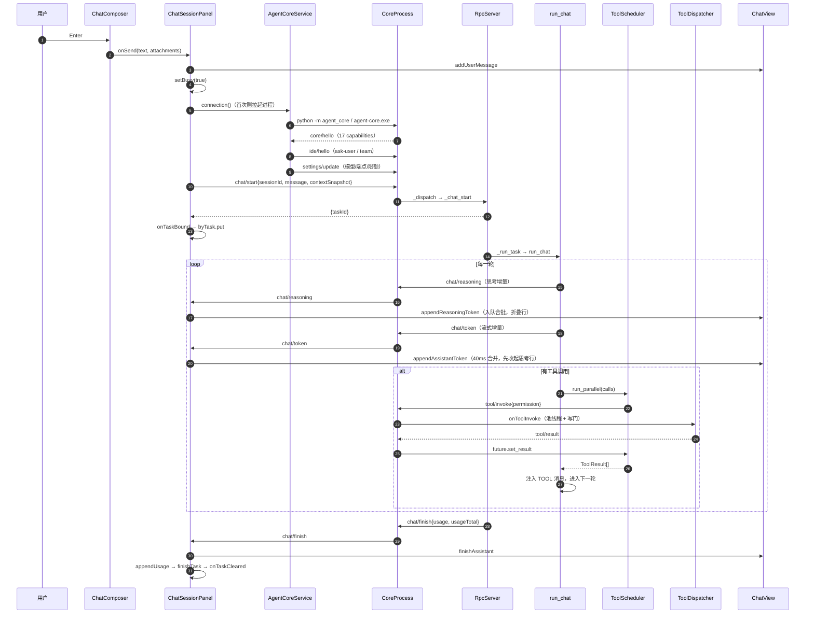

# 第 01 卷 · 一次请求的完整生命周期

> 本卷只回答一个问题：**用户按下一个回车，到屏幕上出现第一段回答，中间到底发生了什么？**
>
> 覆盖范围（按调用顺序）：`ChatComposer` → `ChatSessionPanel` → `AgentCoreService` → `CoreProcess` → `JsonRpcConnection` → `RpcServer` → `run_chat` → `ToolScheduler` → `RemoteToolProxy` → `ToolDispatcher` → 回到 `ChatView`。
>
> 读法：每个函数给出「职责 / 逐行要点 / 为什么这样写」。细节实现（比如某个工具怎么读文件、某个 View 怎么画圆角）留给对应分卷，这里只讲到「接口边界」。

---

## 0. 全景：十步走完一个回合

| 步 | 位置 | 动作 |
|---|---|---|
| 1 | `ChatComposer.installInputBindings()`（562） | Enter 绑定 `chat-send`，busy 时降级为换行 |
| 2 | `ChatSessionPanel.sendMessage()`（498） | 落用户气泡、清输入框、置忙、开计时 |
| 3 | `AgentCoreService.connection()`（71） | 首次使用时拉起 Core 进程并握手 |
| 4 | `JsonRpcConnection.request("chat/start")`（101） | 写一行 JSON 到 Core 的 stdin，挂一个 future |
| 5 | `RpcServer._dispatch()`（234） | Core 从 stdin 队列取帧，区分通知/请求 |
| 6 | `RpcServer._chat_start()`（490） | 建/取会话、算标题、生成 `taskId`、起后台任务 |
| 7 | `RpcServer._run_task()`（549） | 组装回调，调 `run_chat()` |
| 8 | `run_chat()`（90） | 循环：裁剪上下文 → 调 LLM → 有工具就并行执行 → 再调 LLM |
| 9 | `ToolScheduler.run_parallel()`（51） → `tool/invoke` → `ToolDispatcher` | 工具在 Shell 侧真实执行，结果回传 |
| 10 | `chat/finish` → `ChatSessionPanel.onCoreMessage()`（613） | 收尾：结束气泡、显示用量、清 busy、释放 `taskId` |

⚠️ 注意第 5–10 步全部发生在一个 **独立进程** 里；Shell 与 Core 之间只有 stdin/stdout 上的 JSON 行，没有任何共享内存。

---

## 1. 进程是从哪一刻被拉起来的

Core 不是插件启动时就常驻的，而是**第一次真正需要它的时候**才启动，且**一个 IDE 项目一个进程**。

### 1.1 `AgentCoreService.connection()`（`AgentCoreService.java:71-103`）

职责：懒启动 + 复用 + 双模式（打包可执行文件 / Python 源码）。

逐行要点：

- `synchronized (lock)`：整个启动过程串行化。两个标签同时首次发送时，第二个线程会在这里等，避免起两个进程。
- `if (disposed) throw`：项目关闭后不再启动新进程（`dispose()` 在 L223-226 把 `disposed` 置真）。
- `if (connection != null && connection.isAlive()) return`：复用。`isAlive()` 同时检查连接标志与子进程存活，进程被手动 kill 后会重起。
- L80 `PythonLocator.locateCoreExe(state.coreExePath)`：优先打包产物（插件 zip 里的 `<plugin>/agent-core/agent-core.exe`）。
- L82-83 找到 exe → `startExecutable`；否则 L85 找 Python 解释器，**两个都找不到就抛出可操作的错误文案**（提示填设置或设环境变量），而不是抛一个空指针让人猜。
- L90-93 找 `core` 源码目录 → 同样给出明确错误。
- L96-98 建连接、挂通知处理器、起读线程。
- L99-100 `sendIdeHello` + `pushSettings`：**握手与配置都在连接建立后、任何业务请求之前完成**，所以 Core 收到的第一条业务帧一定带着正确配置。

📌 为什么不用 IDE 的 `StartupActivity` 预热？——冷启动要 0.5~2 秒，而很多用户从不开 Agent 面板；懒启动把成本摊到真正使用的那一刻，并且不影响 IDE 启动时间。

### 1.2 `PythonLocator`（`PythonLocator.java`）

四个函数，四套「显式配置 → 环境变量 → 自动探测」的降级链：

| 函数 | 解析顺序 | 校验方式 |
|---|---|---|
| `locateCoreExe(String)`（78） | 参数 → `AGENT_CORE_EXE` → `bundledCoreExe()` → 从 cwd 向上找 `core/dist/agent-core`、`dist/agent-core` | `Files.isRegularFile` |
| `locatePython(String)`（26） | 参数 → `AGENT_PYTHON` → `python` / `python3` | 真的跑一次 `python --version`，3 秒内退出且 `exitValue()==0` |
| `locateCoreHome(String)`（44） | 参数 → `AGENT_CORE_HOME` → 从 cwd 逐级向上找 `core/` | 必须存在 `core/src/agent_core` 目录 |
| `bundledCoreExe()`（130） | 插件描述符 → `<pluginPath>/agent-core/agent-core[.exe]` | 存在文件；unix 上补 `setExecutable(true)` |

⚠️ 三个易错点：

1. `isExecutable()` 会**真启动子进程**。`locatePython` 每次冷启动最多跑 2 次，这也是首次发送比后续慢一截的原因之一。
2. `bundledCoreExe()` 用 `PluginManagerCore.getPlugin(PluginId.getId("com.workreport.ai-assistant"))` 拿安装目录——插件 id 改了但这里没改，就会静默回退到 Python 模式。
3. 从 cwd 向上查找依赖 `user.dir`。IDE 的 `user.dir` 通常是被打开的项目根，而不是插件目录，所以「源码运行插件」时这条路径才有效。

### 1.3 `CoreProcess`（`CoreProcess.java`）

职责：**只做进程与管道**，不解析业务。

| 函数 | 行 | 要点 |
|---|---:|---|
| `start()` | 35-45 | 命令固定为 `python -m agent_core --project-id <id> --data-dir <dir>`；工作目录 `coreHome`；额外环境 `PYTHONPATH=coreHome/src` |
| `startExecutable()` | 49-58 | 工作目录取 exe 的父目录（PyInstaller 单文件需要相对定位资源） |
| `launch()` | 60-71 | 统一设置 `PYTHONIOENCODING=utf-8`——Windows 默认代码页不一定是 UTF-8，不显式指定时中文 JSON 会乱码甚至编码报错；然后 `ProcessBuilder.start()`，把 stdin 包成 UTF-8 的 `BufferedWriter` |
| `startStderrPump()` | 75-95 | 守护线程持续读 stderr → 写 IDE 日志，并保留最后 50 行（`MAX_STDERR_LINES`）供错误提示 |
| `writeLine()` | 101-114 | `synchronized (writeLock)` + 写一行 + `flush()`。多标签并发发送时保证帧不交错 |
| `dispose()` | 127-147 | 先关 stdin（Core 读到 EOF 会优雅退出），`destroy()`，3 秒不退则 `destroyForcibly()` |

📌 为什么 stdout 只走协议、日志走 stderr？——stdout 是**协议通道**，任何多余的 `print()` 都会让 Shell 侧 JSON 解析失败。所以 `__main__.py` 里 logging 的 handler 是 stderr，不是 stdout（见 1.4）。

⚠️ `writeLine()` 在 `dispose()` 之后调用不会抛异常给调用方：`stdin` 仍是关闭状态的流对象，内部 catch `IOException` 只记 warn。因此「关闭项目瞬间点了发送」表现为**消息石沉大海**而不是崩溃，这是有意的。

### 1.4 `__main__.main()`（`core/src/agent_core/__main__.py:55-104`）

Core 侧入口，按顺序做四件事：

1. `argparse`：`--project-id`、`--data-dir`、`--log-level`、`--log-file`、`--no-log-file`、`--version`、`--native-info`。
2. `--native-info` 提前返回：打印 Rust 加速后端信息后退出（`agent_core.native.native_info()`），这是一个**诊断开关**，不启动服务。
3. `_configure_streams()`（18-24）：把 stdin/stdout/stderr 全部 `reconfigure(encoding="utf-8", errors="replace")`。`errors="replace"` 保证坏字节不会让整个进程崩在编码异常上。
4. `_configure_logging()`（33-52）：stderr + `RotatingFileHandler(maxBytes=5MB, backupCount=5)`，默认文件 `~/.agent/logs/core-YYYYMMDD.log`（受 `AGENT_LOG_DIR` 覆盖）。

最后 `asyncio.run(RpcServer(...).run())`。

---

## 2. 连接层：一行一个 JSON

### 2.1 `JsonRpcConnection`（`JsonRpcConnection.java`）

职责：**信封层**。它不懂 `chat/start` 是什么意思，只负责「按 id 配对」与「把通知交给处理器」。

| 元素 | 行 | 说明 |
|---|---:|---|
| `pending` | 31 | `ConcurrentHashMap<String, CompletableFuture<JsonObject>>`，id → 等待者 |
| `notificationHandlers` | 32 | `CopyOnWriteArrayList`，允许注册多个（当前只有 `AgentCoreService::dispatch`） |
| `start()` | 45-49 | 起名为 `agent-core-reader` 的**守护线程**，跑 `readLoop()` |
| `readLoop()` | 51-79 | 逐行读 stdout → `trim` → 空行跳过 → `JsonParser.parseString` → `dispatch` |
| `dispatch()` | 81-99 | **有 `method` 就是通知**（广播给所有 handler 后 return）；**有 `id` 就是响应**（`pending.remove(id)` 并 `complete`） |
| `request()` | 101-112 | 生成 UUID → 先放入 `pending` → 再写帧。**顺序不能反**：先写后挂会产生「响应比 future 先到」的丢失竞态 |
| `notify()` | 114-119 | 无 id，不建 future |
| `dispose()` | 125-136 | 置 `running=false` → `join(1000)` → 关进程 |

⚠️ 三个关键细节：

1. **解析失败只丢帧不崩连接**（L63-66）：`LOG.warn("drop invalid core frame")`。因为日志/第三方库偶尔往 stdout 打一行，不能因此断掉整个会话。
2. **流关闭时把所有 pending 置为异常**（L73-78）：否则 `thenAccept` 永远不会触发，UI 会永远停在「思考中」。
3. 判定顺序是「先 method、后 id」。协议规定一帧不能既是通知又是响应，Core 也不会发这种帧。

📌 为什么自己写而不上 LSP4J / JSON-RPC 库？——只有三种信封（request/response/notification），依赖越小，打包（PyInstaller + 插件 zip）越稳。

### 2.2 握手：`sendIdeHello()`（`AgentCoreService.java:177-189`）

```json
{"method":"ide/hello","params":{"protocolVersion":"1.0","ide":"intellij","capabilities":["ask-user","team"]}}
```

- 只有声明了 `ask-user`，Core 才会发 `ask/user`。旧版 Shell 不声明 → Core 的 `ask_user` 工具直接返回 `None`，模型带着假设继续，而不是白等 30 分钟（`server.py:857-859`）。
- 3.3.0 多声明的 `team` 决定**预审卡**：不声明时 Core 的 `_preapprove_via_shell()`（823-849）直接返回 False，退化成每次写入单独确认（`server.py:829-831`）。
- 这里同时说明了**能力协商的方向**：能力由 Shell 上报，Core 只做降级，不做版本比较。

### 2.3 配置下发：`pushSettings()`（`AgentCoreService.java:126-163`）

每次发送前都会推一次（`ChatSessionPanel.sendMessage` L540），所以改模型/端点不需要重启 Core。

| 键 | 来源 | 备注 |
|---|---|---|
| `provider` | `ModelEndpoints.detect(profile.provider, profile.baseUrl)` | **端点形状优先**：OpenAI 形状的网关即使选了 ollama 也要带 Key |
| `base_url` / `model` / `api_key` | 当前 profile | `api_key` 为空时**不下发该键**，避免覆盖 Core 里已有的值 |
| `embedding_model` | `state.embeddingModel` | 语义索引用 |
| `max_iterations` | `state.maxIterations`（默认 40） | 轮次预算 |
| `context_window` | `state.contextWindow`（默认 32000） | 0 会让 Core 回退 `DEFAULT_BUDGET=24000` |
| `tool_concurrency` / `subagent_concurrency` | 设置页 | 工具/子代理并发上限 |
| `temperature` / `max_tokens` | 设置页 | 采样参数 |
| `active_team` | `state.activeTeam` | 3.3.0 团队开关；空串 = 不启用（Core 默认值），切团队与换模型同一条通道 |
| `command_allowlist` | `splitAllowlist(state.commandAllowlist)` | 逐行解析，跳过空行与 `#` 注释；**空列表 = 用 Core 内置白名单** |
| `mcp_servers` | `parseMcpServers(state.mcpServersJson)` | 只接受 JSON 数组或对象；非法 JSON 记 warn 后忽略，不清空已有配置 |

Core 侧接收在 `_apply_settings()`（`server.py:457-475`）：用 `ChatConfig.model_fields` 过滤未知键，**merge 到旧配置**而不是整体替换——所以「只切模型」的局部 payload 不会把 `max_iterations` 冲回默认值；`mcp_servers` 变了才会 `_schedule_mcp_refresh()`（472-475）。

⚠️ `parseMcpServers` 返回 `gson.JsonElement`。同一进程里 Java 侧与 Python 侧都把它当普通 JSON 处理，没有类型约束，**MCP 配置写错字段名不会报错，只会静默地一个服务都不加载**。

---

## 3. 用户按下回车

### 3.1 `ChatComposer.installInputBindings()`（`ChatComposer.java:562-584`）

- L564-565：`Enter` 与 `Ctrl+Enter` 都映射到 `"chat-send"`。
- L569-570：`Shift+Enter` 映射到 `DefaultEditorKit.insertBreakAction`。⚠️ **原生 `JTextArea` 根本没有 Shift+Enter 绑定**，不显式接回去，按下去既不发送也不换行（历史 bug）。
- L571-583：`chat-send` 的 Action —— busy 时**把回车降级为换行**（L578 `input.replaceSelection("\n")`），而不是吞掉按键。

### 3.2 `ChatComposer.triggerSend()`（`ChatComposer.java:369-378`）

```
busy? → return
（否则）text = input.getText().trim()
text 为空 且 无附件? → return
listener.onSend(text, List.copyOf(attachments))
```

⚠️ **busy 时这里是直接 return 而不是 `onStop()`**：「一个按钮两种语义」靠的是按钮自己的 Action（L165-170）：忙时图标换成方块、点击调 `listener.onStop()`；`triggerSend()` 只负责「空闲时的发送判定」。

`List.copyOf` 是**快照**：发送后用户立刻删附件，不会影响已经交出去的这一批。

### 3.3 `ChatSessionPanel.sendMessage()`（`ChatSessionPanel.java:498-567`）

这是整个 Java 侧最重要的函数，逐行拆：

| 行 | 代码意图 | 为什么 |
|---|---|---|
| 499-502 | `currentTaskId != null` → 提示「还有任务在跑」 | 一个标签同时只允许一个任务；并发靠开新标签实现 |
| 503-509 | 归一化：`null → ""`、`trim`、全空且无附件则返回 | 防止发一条空消息消耗一次 LLM 调用 |
| 510-514 | 收集附件显示名（项目相对路径优先） | 气泡里显示短路径，而不是绝对路径 |
| 515 | `transcript.addUserMessage(text, names)` | **先落 UI**，再发网络请求：用户立刻看到自己的消息 |
| 516-517 | `composer.reset()` + `updateTitleFrom(text)` | 清空输入、收回到基础高度；首个消息前 14 字成为标签标题 |
| 520-526 | 开计时、清零 `turnIn/turnOut`、清空在途工具表、刷新 chip | 右侧 `模型 · in/out · 秒数` 的来源 |
| 527-528 | `setBusy(true)` + 状态「思考中」 | 发送按钮变停止、状态行提示 |
| 531 | `executeOnPooledThread` | **连接与 RPC 都是阻塞 IO，绝不能在 EDT 上做** |
| 533-537 | `ensureStarted()` → `connectionOrNull()` | 首次发送触发进程启动；拿不到连接就按错误处理 |
| 540 | `pushSettings(conn)` | 让设置页的修改即时生效 |
| 541-544 | 组装 `sessionId` / `message` / `contextSnapshot` | `message` 已经过 `ChatAttachment.buildPrompt` 拼装 |
| 545-560 | `request("chat/start")` → `thenAccept` / `exceptionally` | 成功时取 `result.taskId`，**先登记再让事件流动**；失败/异常都收尾 |
| 561-565 | 同步异常同样收尾 | `ensureStarted` 抛 `IOException` 走这里 |

⚠️ 三个容易误读的地方：

1. **`currentTaskId` 是在 `thenAccept` 里才赋值的**（L549）。从 `setBusy(true)` 到 `chat/start` 返回之间，`isBusy()` 与 `taskId()` 都还是「空闲」。这期间唯一的闸门是 `ChatComposer.busy`（`triggerSend` 直接 return）；`sendPresetMessage()`（485-494）虽然也检查 `currentTaskId`，但同样落在这个窗口里。**结论：任何新增的发送入口都必须同时判 `composer.isBusy()`，只判 `currentTaskId` 会漏。**
2. **`owner.onTaskBound(this, taskId)` 必须早于第一个 `chat/token`**（L545-552 注释）。Core 侧能保证这一点，见 4.1 的解释。
3. `params.put("message", ChatAttachment.buildPrompt(...))`：附件不是单独字段，而是**拼进 user 消息正文**，所以 Core 不需要理解附件概念。

### 3.4 `ChatAttachment.buildPrompt()`（`ChatAttachment.java:30-70`）

预算优先级：`MAX_TOTAL_CHARS=120_000` 总量 → 每文件 `MAX_FILE_CHARS=40_000` → 单文件超过 `512 KB` 或含 `\0`（二进制探测前 4096 字节）则**不内联**，只给绝对路径并提示「用 read_file 读取」。

- 目录不内联，提示用 `list_dir` / `read_file`。
- 截断时明确写出「以上为前 N 个字符，原文件共 M 个字符」，避免模型以为拿到的是全文。
- 代码块围栏按扩展名给语言标注（`fenceLanguage`，126-154），让模型正确识别语法。

📌 为什么不把附件作为独立字段上传？——因为 LLM 只认 messages；把附件变成「user 正文的一部分」可以让**任何一个** provider 都工作，不需要每家都理解附件协议。

### 3.5 `buildContextSnapshot()`（`ChatSessionPanel.java:586-607`）

只放四个键：`project_root`、`current_file`（当前选中编辑器对应文件）、`open_files`（附件路径）。Core 侧用 `ContextSnapshot` 校验，失败只记 warn。

`project_root` 的作用不只是提示：`_bind_project_root()`（`server.py:534-547`）会用它**重建** MemoryService / SkillService / MCPManager，重设索引根目录，并把子代理与**团队**（3.3.0）名册重新指向该项目。也就是说，第一次带上项目根之后，Core 才知道去哪找项目记忆、技能与 MCP 配置。

---

## 4. Core 收单

### 4.1 `RpcServer._dispatch()`（`core/src/agent_core/rpc/server.py:234-263`）

```
method 缺失 → return（这是对 Core 发起请求的响应；当前 Core 只发通知，所以无需处理）
id  缺失   → _handle_notification()
inline/complete、index/build → create_task（长耗时，不能堵 stdin 循环）
其它 → await _handle_request() → make_response / make_error
```

⚠️ **为什么 `inline/complete` 与 `index/build` 要单独拎出来**？因为它们会跑几秒到几分钟。stdin 循环是单线程串行的，一旦在这里 await，期间到达的 `chat/cancel`、`tool/result` 全部排队 → 编辑器补全会把聊天卡死（源码注释原话）。

📌 **为什么 `chat/start` 反而不用 create_task？** 因为 `_chat_start()` 自己只做「登记 + `create_task(self._run_task(...))`」就立刻返回（L511-517）。于是 `_dispatch` 紧接着就写出了 response。Python 的 `create_task` 只是**排队**，真正的协程要等当前协程让出事件循环才跑，所以 **`chat/start` 的响应一定先于第一条 `chat/token` 写出**——这正是 Java 侧 `onTaskBound` 能先登记的前提。

### 4.2 `_handle_request()`（`server.py:265-309`）

16 个方法的路由表（完整语义见第 03 卷）：

| 方法 | 返回 |
|---|---|
| `chat/start` | `{"taskId": ...}` |
| `ping` | `{"pong": true}` |
| `tool/result` | `{"received": true}`（唤醒挂起的 future） |
| `agent/confirmResult` | `{"received": true}` |
| `ask/userAnswer` | `{"received": true}` |
| `index/status` | 索引统计 |
| `session/list` / `session/get` / `session/delete` / `session/search` | 会话存储与检索 |
| `memory/pending` / `memory/promote` / `memory/discard` | 记忆候选 |
| `usage/report` | 用量报表 |
| `team/list` / `team/artifacts` | 团队名册 / 黑板交付物（3.3.0） |

未知方法统一 `RpcError(PROTOCOL_ERROR, "unknown method: ...")`。

### 4.3 `_chat_start()`（`server.py:490-517`）

| 行 | 动作 | 细节 |
|---|---|---|
| 491-494 | 取 `sessionId`、`message`；空消息直接 `PROTOCOL_ERROR` | 服务端也要校验，不能只靠前端 |
| 496 | `sessions.get_or_create(session_id)` | 同一 `sessionId` 复现历史 → 「接着聊」 |
| 499-500 | 首条消息生成标题 `make_title(user_input)` | 与 Java 侧 `shorten()` 生成本地标题是两条独立路径 |
| 501 | `session.touch()` | 更新 `updatedAt`，影响历史列表排序 |
| 502-509 | 解析 `contextSnapshot`，失败只 warn | 快照是「锦上添花」，不能因为一个坏字段拒绝服务 |
| 511 | `task_id = uuid4().hex[:12]` | 12 位十六进制，足够区分同项目的并发任务 |
| 512-516 | `create_task(_run_task(...))`、登记 `_tasks` 与 `_task_sessions`、挂 done 回调清理 | `_task_sessions` 让「删除会话」能取消该会话在跑的任务 |

---

## 5. 任务主体：`_run_task()`（`server.py:549-666`）

这是 Core 侧的「sendMessage」，把一次对话的所有阶段粘在一起。

### 5.1 准备阶段（551-574）

```python
provider = build_provider(self.config)          # 每个任务新建 provider（拿到最新配置）
task_token = _current_task.set(task_id)          # contextvar：工具转发时带上 taskId
todo_token = todo_tools.bind_session(session)    # contextvar：todo_write 写进当前会话
team_token = team_tools.bind_session(session)    # 3.3.0：团队工具写同一会话
run_token = team_tools.bind_run(task_id)         # 3.3.0：预审范围按 run 限定
started = time.monotonic()
tool_calls = 0
usage_total = {}
ok = False
```

📌 3.3.0 起多了两个 `contextvar`（558-559）与一条 `team_runs` 记录（560-570，只保留最近 20 条）：团队名册与预审范围因此不需要逐层传参，也不会跨任务串号。

📌 为什么用 `contextvars` 而不是把 `task_id` 一路透传？——工具 handler 的签名是固定的 `async def handler(call)`，没有位置塞 `taskId`；并发任务又是同一个事件循环里的协程。contextvar 是唯一「不改变接口又能隔离并发」的做法。

### 5.2 五个回调（576-607）

| 回调 | 发给 Shell 的通知 | 字段 |
|---|---|---|
| `emit_token(delta)` | `chat/token` | `taskId`、`delta` |
| `emit_reasoning(delta)` | `chat/reasoning` | `taskId`、`delta`（3.3.0 新增；思考不进会话历史） |
| `on_tool_start(call)` | `chat/toolStart` | `taskId`、`toolCallId`、`toolName`、`args`；同时 `tool_calls += 1`（用量统计用） |
| `on_tool_end(call, result)` | `chat/toolEnd` | `taskId`、`toolCallId`、`ok`、`summary`（换行压成空格、截 300 字） |
| `on_notice(text)` | `chat/notice` | `taskId`、`text`（provider 降级提示，不中断任务） |

### 5.3 调 `run_chat()`（609-625）

传进去的上下文有六个「注入项」：

- `registry=self.tools`：统一的工具表（内置 + 远程 + MCP + 团队动态注册）。
- `memory_overview=self.memory.overview_text()`：记忆索引（只有标题，正文按需 `memory_recall`）。
- `skill_instruction=self.skills.instruction_for(user_input, skill_name)`：命中的技能说明。
- `subagent_catalog=self.subagents.catalog_text()`：可用专家角色清单；**启用团队时传 `None`**（615），改用团队名册。
- `base_prompt`（614）：团队剧本追加到 `SYSTEM_PROMPT` 之后，而不是替掉它。
- `on_reasoning=emit_reasoning`（620）：思考增量走独立通道（3.3.0）。

### 5.4 成功路径（626-637）

```python
self._send_notification("chat/finish", {
    "taskId": task_id, "fullText": result.content,
    "usage": result.usage, "usageTotal": result.usage_total,
})
self._spawn(self._capture_memories(session))
```

- `chat/finish` 带 **最后一轮** `usage` 和**全程累计** `usageTotal`（Shell 右侧 chip 用后者）。
- 记忆抽取只在**正常结束**时做：被取消的那轮可能停在用户想法中间，抽出来的候选是噪声（源码注释 573-575）。

### 5.5 失败与取消（638-653）

| 异常 | 发出的通知 | 注意 |
|---|---|---|
| `asyncio.CancelledError` | `chat/error`，`code=CANCELLED`，`message="已取消"` | **必须捕获并转成通知**，否则 Shell 永远等不到收尾 |
| `RpcError` | 原样带 `code` | 例如上下文溢出、限流 |
| 其它 `Exception` | `LLM_ERROR` + 异常文本 | `_error_text()` 保证不会是空字符串（`httpcore` 超时的 `str(exc)` 可能是空） |

### 5.6 `finally`（654-666）

```python
todo_tools.reset_session(todo_token)
team_tools.reset_session(team_token)     # 3.3.0
team_tools.reset_run(run_token)
self.teams.clear_run(task_id)
_current_task.reset(task_token)
self.sessions.save(session)      # 无论成功失败都落盘
self._record_usage(...)          # 一行 usage.jsonl，ok = 成功且会话未被删除
```

📌 团队任务还会在这里把 `team_runs` 的最后一条补齐（659-662：`ok` / `toolCalls` / `durationMs`），历史对话因此能重建「哪个团队跑了多久」。

📌 `sessions.save()` 放在 finally 而不是成功分支：**取消/报错也要保住已经产生的半截对话**，否则用户点「停止」就丢历史。

---

## 6. 主循环：`run_chat()`（`core/src/agent_core/agent/loop.py:90-200`）

### 6.1 入口与系统提示词（106-125）

```python
session.append(Message(role=USER, content=user_input))
tools = registry.defs() if registry else None
scheduler = ToolScheduler(registry, config.tool_concurrency)
max_iterations = max(1, config.max_iterations)
tracker = PermissionTracker()          # 连续拒绝计数
stats = TurnStats()
usage_total = {"in":0,"out":0,"total":0}
unknown_tools = Counter()
```

系统提示词 = `base_prompt` 或 `SYSTEM_PROMPT`（19-30 行，中文，明确「先读后改」「3 步以上先用 todo_write」「删除用 delete_file」「推送交给用户」）+ 子代理清单 + 记忆索引 + 技能说明。

3.3.0 把 `SYSTEM_PROMPT` 抽成了可覆盖的基底（114 `base_prompt or SYSTEM_PROMPT`）：启用团队时 Shell 不传剧本，而是 Core 把 `SYSTEM_PROMPT + 团队剧本` 拼好从 `base_prompt` 注入（`server.py:610-614`）。

📌 这三段是**按顺序追加**的：子代理 → 记忆 → 技能。技能放最后，因为它最贴近本次任务，位置越靠后模型越容易遵守。

### 6.2 每一轮的开头（126-140）

| 行 | 动作 | 为什么 |
|---|---|---|
| 128 | `[system] + session.messages` | system 不进 session 历史，避免重复累积 |
| 129 | `trim_history(messages, budget_for(config.context_window))` | 预算 = 窗口 × 0.75，夹紧 `[4000, 200000]` |
| 130-134 | 裁剪后没有 `user` 消息 → 把本轮输入补回 | **vLLM 在没有 user 角色时直接 400**（`No user query found in messages.`） |
| 138-140 | `stats.render(max_iterations)` 作为一条 user 消息追加 | 放在裁剪**之后**：状态栏永远不会被裁掉；且只改前缀末尾，前缀缓存命中率高 |

📌 状态栏用 `role=USER` 而不是再插一条 `SYSTEM`：多数 OpenAI 兼容网关只认**第一条** system，追加第二条容易 400；同时 USER 消息在任何裁剪策略下都会被视为「对话内容」，不易被静默丢弃。

### 6.3 调模型（141-150）

```python
result = await provider.chat_stream(messages, tools=tools, config=config,
                                    on_token=emit_token, on_tool_call=_noop_tool_call,
                                    on_reasoning=emit_reasoning)
await _flush_notice(provider, on_notice)
_add_usage(usage_total, result.usage)
```

- `on_reasoning` 是**末位可选参数**（`run_chat(..., on_reasoning=None)`）：旧调用点不传也能跑，只会在 Shell 上少一行思考。
- `on_tool_call` 是空实现：工具调用**不从流式回调里执行**，而是等流结束后从累加器一次性取（`result.tool_calls`）。这样避免「边流边执行」导致的半截 JSON 参数。
- `_flush_notice()`：provider 若把「该端点不支持工具调用」记在内部，这里只上报一次。

### 6.4 没有工具调用（152-155）

```python
session.append(Message(role=ASSISTANT, content=result.content))
result.usage_total = _usage_snapshot(usage_total)
return result
```

`_usage_snapshot()` 在三个计数全为 0 时返回 `None` —— Shell 侧据此**隐藏**用量行（很多自建端点不报 usage）。

### 6.5 有工具调用（157-177）

1. `session.append(ASSISTANT, content, tool_calls)`：assistant 消息必须带 `tool_calls` 原样落库，否则下一轮 `TOOL` 消息找不到宿主。
2. `stats.record_calls()` → 状态栏计数。
3. `scheduler.run_parallel(...)`：并发执行（见第 7 节）。
4. 逐条 `zip(result.tool_calls, tool_results)` 回填：
   - 成功 → `compress_tool_output(name, content, path)` 压缩（例如超长文件只留签名/关键段）。
   - 失败 → `"ERROR: " + error`。
   - 都包成 `Message(role=TOOL, tool_call_id=..., name=..., content=...)`。
5. `unknown_tools[call.name] += 1` 仅当错误以「未知工具」开头。
6. `tracker.record_result(ok, error)`：连续 3 次「用户拒绝」→ 返回 True。

### 6.6 三种提前终止（179-199）

| 条件 | 结束语 | 目的 |
|---|---|---|
| 同一未知工具 ≥ 3 次（`UNKNOWN_TOOL_LIMIT`） | 「模型反复要求调用不存在的工具「X」…」 | 防止模型把 40 轮预算都烧在 `bash`/`Grep` 这种不存在的名字上 |
| 连续拒绝 ≥ 3 次 | 「连续多次未获得授权，已停止工具执行…」 | 防止「弹窗 → 拒绝 → 再弹」的死循环 |
| 跑满 `max_iterations` | 「（已达到最大迭代轮次 N…回复「继续」可接着跑。）」 | 明确告知未完成，而不是假装完成 |

⚠️ 三种终止都会把结束语**写进 session**，所以下一次「继续」能接上——这是「可续跑」的关键。

---

## 7. 并发执行：`ToolScheduler.run_parallel()`（`agent/scheduler.py:51-108`）

| 行 | 要点 |
|---|---|
| 57 | `Semaphore(max_concurrency)`：默认 4，来自 `settings.tool_concurrency` |
| 60-66 | 工具不存在 → `unknown_tool_error()`（**列出真实工具名**，最多 12 个）；存在但无 handler → 「工具未实现」 |
| 68 | `async with semaphore`：并发上限在**执行**处，不在排队处 |
| 69-70 | `on_start` 先于执行 → UI 能立刻显示工具行（`read_file · path`） |
| 72 | `wait_for(handler(call), timeout=tool_def.timeout_sec)`：**每个工具自带超时** |
| 73-74 | 超时 → `ToolResult(ok=False, error="工具执行超时")`，不抛异常 |
| 75-76 | `CancelledError` **必须重新抛出**：用户点「停止」时要真的停，而不是把它当成普通失败 |
| 94-102 | 交互式工具（`ask_user`）**先单独跑**，其余才并行 | 原因：边改文件边等用户回答，回答到达时文件已变（注释 24-27） |
| 104-108 | 按**调用方顺序**返回结果 | `loop` 用 `zip` 回填 `tool_calls`，顺序错位会把结果配给错误的工具 |

⚠️ 超时后 Shell 侧的进程/耗时操作可能仍在跑，它晚到的 `tool/result` 会因为 `_pending_tools` 里已经没有这个 id 而**被静默丢弃**（`_tool_result` 只在 future 存在时 set_result）。这是设计上的「孤儿结果」，不会污染下一轮。

---

## 8. 工具往返：一次跨进程的「伪同步调用」

### 8.1 Core 侧发起：`_invoke_shell_tool()`（`server.py:746-795`）

```python
tool_def = self.tools.get(call.name)
permission = tool_def.permission.value if tool_def else Permission.AUTO.value
if call.name == "run_command":
    decision = decide_command(command, self.config.command_allowlist)
    if decision == "deny": return ToolResult(ok=False, error="已拒绝执行危险命令: ...")
    permission = decision          # auto / confirm
elif call.name in WRITE_TOOL_NAMES and self.teams.active_team() is not None:
    if self.teams.should_auto_write(_current_task.get(), path):
        permission = Permission.AUTO.value     # 3.3.0 预审通过只豁免本阶段常规写
future = loop.create_future()
self._pending_tools[call.id] = future
payload = {taskId, toolCallId, toolName, params, permission}
if member: payload["member"] = 成员显示名     # 3.3.0 卡片标注「来自 全栈工程师」
self._send_notification("tool/invoke", payload)
try:    return await future
finally: self._pending_tools.pop(call.id, None)
```

五个设计点：

1. **`tool/invoke` 是通知，不是请求**。Core 不等回包，而是挂一个 future，然后继续处理 stdin 上的其它帧。这样 4 个工具并发时，4 个 future 同时在等，互不阻塞。
2. **权限在 Core 计算**（`commands.decide()`）：`DENY_PATTERNS` → `deny`；命中白名单前缀 → `auto`；其余 → `confirm`。策略随调用下发，两个 IDE 行为一致。
3. 危险命令**在 Core 就直接拒绝**，连 Shell 都不通知——`rm -rf /`、`git push --force` 这类命令没有「点确认就能执行」的路径。
4. `finally` 里 pop：无论正常返回、超时、取消，都不留悬挂引用。
5. **团队预审把「本阶段内的写」降为 auto**（767-772）：`should_auto_write(taskId, path)` 只在已批准且路径在声明范围内时返回真；删除与危险命令仍走原权限（`WRITE_TOOL_NAMES` 刻意不含 `delete_file`）。

### 8.2 Shell 侧路由：`AgentChatPanel.onCoreMessage()`（`AgentChatPanel.java:871-916`）

```
没有 method → 忽略
taskId 为空 → 全局事件（core/hello、memory/pendingChanged、session/indexProgress）
否则 byTask.get(taskId) → target.onCoreMessage(method, params)
```

`byTask` 的写入点在 `SessionOwner.onTaskBound()`（L1011-1014），清除点在 `onTaskCleared()`（L1017-1020，`byTask.values().remove(session)` 会把该会话的所有 taskId 映射一起删掉）。

⚠️ 若 `chat/start` 的响应还没到就收到了该 task 的帧，会走 `LOG.debug("unrouted core event")` 被丢弃。理论上不会发生（见 4.1），但这是排障时第一个要看的日志。

### 8.3 Shell 侧执行：`ToolDispatcher.onToolInvoke()`（`ToolDispatcher.java:51-98`，四参重载；两参版本 L45-47 只做转发）

| 行 | 动作 | 说明 |
|---|---|---|
| 53-58 | 解析 `toolCallId` / `toolName` / `permission` / `params` | `permission` 缺省 `"auto"` |
| 67-69 | `autoAccept = state.autoAcceptEdits`；`writeOp = WRITE_TOOLS.contains(name)`；`needsApproval = !"auto".equals(permission) && !(writeOp && autoAccept)` | **自动执行只降级写操作**；`run_command` 的 `confirm` 永远不会被自动接受覆盖 |
| 70 | `label` = 会话标题（排队提示用） | 未命名时回退「会话」 |
| 71 | `executeOnPooledThread` | 工具执行是阻塞 IO，绝不在 EDT |
| 72-79 | 写操作先 `writeGate.acquire(label)`，被排队时 `notice` 写一行英文日志 `queued · waiting for session X · toolName` | 并行标签同时改文件时串行化 |
| 81-85 | `dispatch()` 包 try/catch，异常转 `ToolResult.fail` | 工具异常不能把线程池线程炸掉 |
| 86-90 | `finally { writeGate.release(); }` | 必须释放，否则其它会话永远排队 |
| 91-96 | 组装 `{toolCallId, ok, result, error}` → `connection.request("tool/result", payload)` | 用**请求**而不是通知，能拿到 `{"received": true}` 确认 |

`dispatch()`（100-127）是纯 switch，把 11 个工具名映射到实现类（实现细节见第 06 卷）；参数 `needsApproval` 只对写/命令类生效。未知名返回 `ToolResult.fail("未知工具: ...")`。

### 8.4 回到 Core：`_tool_result()`（`server.py:374-385`）

```python
result = ToolResult(tool_call_id=..., ok=bool(params.get("ok")),
                    content=params.get("result"), error=params.get("error"))
future = self._pending_tools.pop(tool_call_id, None)
if future is not None and not future.done():
    future.set_result(result)
return {"received": True}
```

`await future` 解除阻塞 → `run_parallel` 拿到结果 → `on_tool_end` 发 `chat/toolEnd` → `loop` 注入 TOOL 消息 → 下一轮。

---

## 9. 阻塞式交互：确认与提问

这两条路径与工具调用**结构相同**（通知 + future + 请求唤醒），区别是「等的是人」。

### 9.1 MCP 确认与团队预审：`_confirm_via_shell()` / `_preapprove_via_shell()`（`server.py:799-817` / `823-849`）

- 生成 `confirmId` → 发 `agent/confirm{confirmId,taskId,kind:"mcp",server,tool,args}` → `wait_for(future, 120.0)`；超时视为**拒绝**。
- 3.3.0 新增的预审走同一张应答通道，只是 `kind="preapprove"`，载荷换成 `{plan, firstDiff, files[]}`；Shell 没声明 `team` 能力时 `_preapprove_via_shell()` 直接返回 False（829-831），退化为逐次确认。
- ⚠️ **只有 MCP 调用与团队预审走这条路径**。文件写操作的 diff 确认是 Shell 内部行为（`EditTools` + `DiffConfirmCard`），Core 只发 `tool/invoke` 带 `permission=preview`。

Shell 侧 `ChatSessionPanel.handleConfirm()`（792-830）：

1. `kind="preapprove"` 先分流到 `handlePreapprove()`（832-889）：计划 + 文件清单 + 首个 diff 拼成一张卡。
2. `transcript.isShowing()` 且 `addCard` 成功 → 在对话区插一张 `ToolCallCard`，回车/ESC 即可回答，调用前的上下文不被遮挡。
3. 否则（切到别的标签、工具窗收起）→ `askConfirmInDialog()`（893-900）退化为模态对话框。
4. 用户回答 → `sendConfirmResult()`（902-919）→ `agent/confirmResult{confirmId, approved}`。

### 9.2 提问：`_ask_via_shell()`（`server.py:856-881`）

- L857-859：Shell 没声明 `ask-user` → 直接返回 `None`（模型继续）。
- 超时 `ASK_TIMEOUT = 1800.0`（30 分钟）；超时或被取消时补发 `ask/withdraw{askId}` 让卡片收起（877-881）。
- Shell 侧 `handleAsk()`（922-948）→ `buildAskCard()`（949-980）逐题构造 → `askInDialog()`（1085-1149）逐题弹框（多选降级单选）。

### 9.3 标签关闭时的兜底（`ChatSessionPanel.dispose()` 1312-1328）

```java
for (ToolCallCard card : pendingConfirms) card.decide(false);   // 一律拒绝
for (AskCard card : pendingAsks)         card.skip();           // 一律跳过
transcript.dispose();
```

📌 必须先 `onStop()` 再兜底：先取消任务，再回答悬挂的确认/提问。否则 Core 会在「任务已取消」之后收到一个毫无意义的回答。**不兜底的后果是 Core 卡在 `await future` 上 120 秒 / 30 分钟**，期间该会话无法再发送。

---

## 10. 流式回到界面

### 10.1 `ChatSessionPanel.onCoreMessage()`（613-758）

| method | 处理 |
|---|---|
| `chat/token` | `transcript.appendAssistantToken(delta)` |
| `chat/reasoning` | `transcript.appendReasoningToken(delta)`（思考折叠行，不进历史） |
| `tool/invoke` | `toolDispatcher.onToolInvoke(params, conn, displayTitle(), transcript::addToolLine)` |
| `chat/toolStart` | 追加英文日志行 `read_file · src/main/App.java` |
| `chat/toolEnd` | 追加 `read_file · done · 0.4s · 摘要（截 120）`（`done` / `failed`） |
| `chat/subagent` | `kind=start` 显示 `agent id · model [cap] · start`；`end` 显示 `· done · 12.4s · 摘要` |
| `chat/artifact` | 团队黑板投稿：一行提示 + 点亮输入区的「交付物」入口 |
| `chat/notice` | `transcript.addNotice(text)` |
| `chat/todos` | `todoStrip.setItems(parseTodos(params))` |
| `agent/confirm` | `handleConfirm()` |
| `ask/user` | `handleAsk()` |
| `ask/withdraw` | 从 `pendingAsks` 取卡片 → `card.withdraw()` |
| `chat/finish` | `finishAssistant()` → `appendUsage()` → `finishTask()` → 状态「就绪」 |
| `chat/error` | 红色错误行 `[错误:CODE] message` → `finishTask()` → 状态「错误」 |

⚠️ `default: break` 是**故意留空**的：Core 未来新增通知不会让旧 Shell 崩，只是不显示。

⚠️ 入口处（619-630）已经在读线程上分流：`chat/token` / `chat/reasoning` 直接入队，
其余分支 `invokeLater` 到 EDT（第 08 卷 §15.2）。

### 10.2 渲染合并：`ChatView.appendAssistantToken()`（`ChatView.java:141-176`）

- `FLUSH_MS = 40`：token 先进缓冲，由一个不重复的 `Timer` 在 40 ms 后统一 `flushNow()`（L362）。
- 思考过程走同一条合批路径（`appendReasoningToken` → `pendingReasoning` / `reasoningBuffer`），
  `flushNow()` 同时检查 `reasoningDirty` 与 `dirty`——只处理正文会让「只有思考、还没正文」的画面卡住。
- 目的：模型每秒可能吐 50~200 个 token，**每次 token 都重排一次 Swing 会让 EDT 打满**。40 ms ≈ 25 fps，人眼看起来仍是连续输出。
- 只有尾块重新解析（`IncrementalParser`），前面的块复用已渲染组件——细节见第 08 卷。

### 10.3 收尾：`finishTask()` / `appendUsage()`（1182-1218）

```java
currentTaskId = null;
setBusy(false);          // invokeLater：composer/statusRow/owner 都在 EDT 上
refreshMeta();           // 用 turnIn/turnOut/turnStartMs 拼 chip
owner.onTaskCleared(this);   // 容器删掉 byTask 映射
```

`appendUsage()` 读 `usageTotal.in/out`，写进 `turnIn/turnOut`，并在两者都非 0 时追加一条「本轮用量：x 输入 / y 输出」。`formatTokens()` 在 ≥1000 时显示 `1.2k`。

---

## 11. 全链路时序图



---

## 12. 八条常见误解

1. **「diff 确认走 `agent/confirm`」** ❌。`agent/confirm` 只用于 MCP（`kind="mcp"`）。文件写操作的确认由 Shell 自己弹（`permission=preview` → `DiffConfirmCard`）。
2. **「Core 会等 Shell 弹完确认再决定是否执行」** ❌。Core 已经把权限算完并随 `tool/invoke` 下发；Shell 只是执行这个决定。
3. **「`chat/start` 是同步阻塞的」** ❌。它立刻返回 `taskId`，真正的执行在后台 task 里。
4. **「停止 = 杀掉 Core 进程」** ❌。`chat/cancel` 只取消对应的 asyncio task，进程与其它会话都不受影响。
5. **「一个标签一个 Core 进程」** ❌。一个 IDE 项目一个进程，标签之间靠 `sessionId` + `taskId` 隔离。
6. **「工具结果直接在流式回调里执行」** ❌。工具调用在流结束后从累加器一次性取出。
7. **「自动执行开关能让 `rm -rf` 免确认」** ❌。`needsApproval` 公式里 `autoAccept` 只影响 `writeOp`；命令策略是 Core 算的。
8. **「记忆是这轮对话的一部分」** ❌。记忆抽取在 `chat/finish` 之后由后台任务做，失败只记日志，绝不影响本轮结果。

---

## 13. 本卷自测清单

```powershell
# 1) 只跑 RPC 冒烟：验证 chat/start → token → finish 的信封正确性
cd core; python scripts/smoke_rpc.py

# 2) 跑工具冒烟：验证 tool/invoke ⇄ tool/result 的配对与 permission 字段
cd core; python scripts/smoke_tools.py

# 3) 跑命令策略：验证 auto / confirm / deny 三分支
cd core; python scripts/smoke_command.py

# 4) 找出「一次请求」涉及的所有行（对照阅读）
#    在 IDE 里对以下符号逐个 Ctrl+Click：
#    ChatSessionPanel.sendMessage / RpcServer._dispatch / RpcServer._run_task
#    run_chat / ToolScheduler.run_parallel / ToolDispatcher.onToolInvoke
```

观察点：

- 发送后 `chat/start` 的响应是否先于第一个 `chat/token`？（Core 日志 + Shell 状态行）
- 点「停止」后是否收到 `chat/error{code:CANCELLED}`，并且 `chat/finish` **没有**出现？
- 关闭一个正在跑的标签，Core 日志里是否出现该 task 的取消、且 120 秒内没有「confirm timeout」？
- 面板勾选「自动执行」后，`run_command` 的确认卡是否**仍然**出现？

---

## 14. 下一卷

第 02 卷从「这个进程是怎么被构建、打包、装配进 IDE 的」讲起：`pom.xml` 的每个插件、`plugin.xml` 的每个扩展点、`assembly/plugin-assembly.xml` 的 zip 布局、`scripts/*.ps1` 的构建与全量回归。
